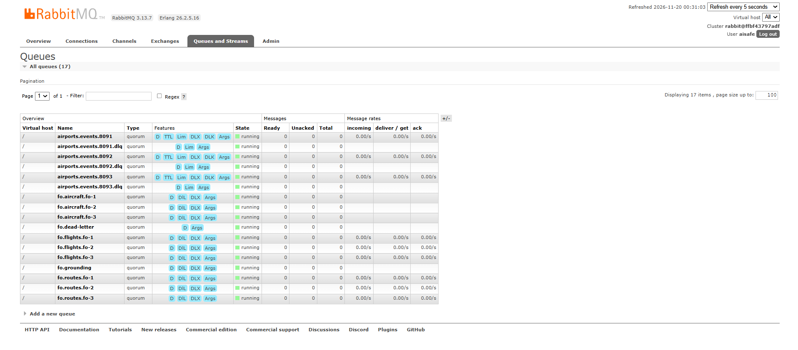
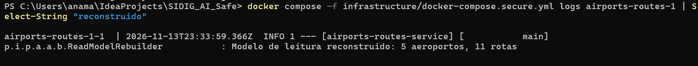
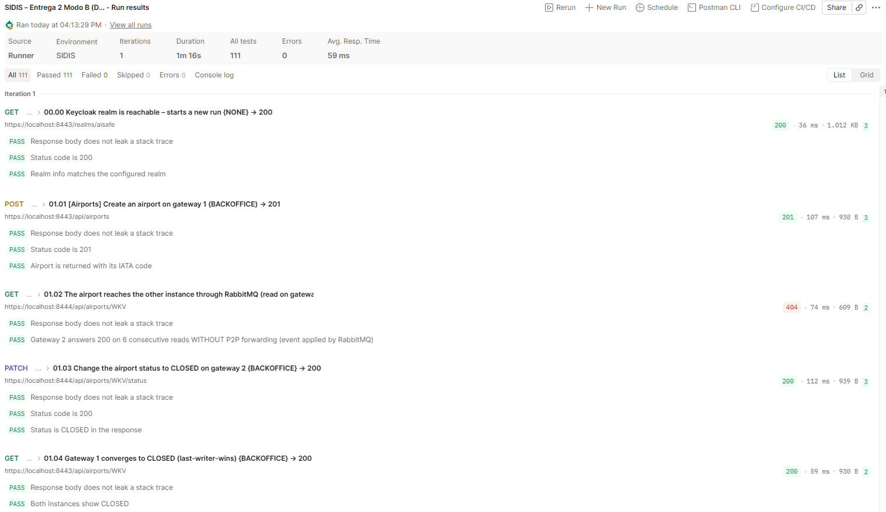
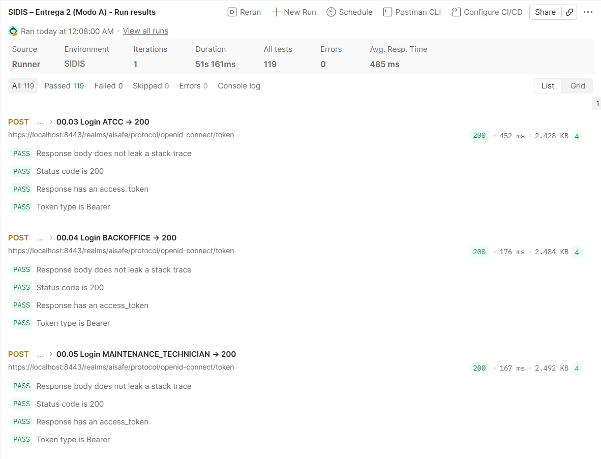
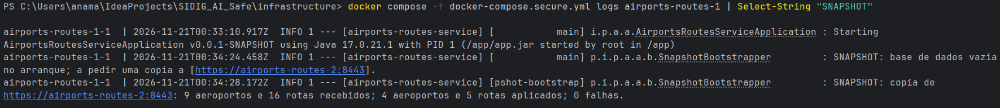
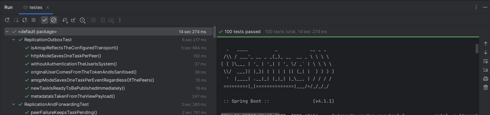

# AISafe – Airports & Routes Service (Entrega 2)

Serviço responsável pelos **aeroportos** e pelas **rotas** da rede. Nesta entrega passou a usar **CQRS**,
a replicar entre instâncias por **mensagens (RabbitMQ)** em vez de HTTP direto, e cada instância tem a
**sua própria base de dados PostgreSQL** (Database-per-Service). Mantém a API REST da Entrega 1.

> A documentação da Entrega 1 está em [`README.md`](README.md).

## Início rápido (Modo B – Docker seguro)

Pré-requisito: Docker Desktop. A partir da pasta `infrastructure` do repositório:

```powershell
copy .env.example .env             # só na primeira vez; depois ver a nota abaixo
.\docker\gen-certs.ps1             # gera os certificados e preenche os segredos CHANGE_ME do .env
docker compose -f docker-compose.secure.yml up --build -d
docker compose -f docker-compose.secure.yml ps
```

Quando tudo estiver `healthy` (o `rabbitmq-init` termina com `Exited (0)`, e isso é o esperado):

| O quê                          | Onde                                                                           |
|--------------------------------|--------------------------------------------------------------------------------|
| Gateway 1 / Gateway 2          | `https://localhost:8443` / `https://localhost:8444`                            |
| Consola RabbitMQ (nós 1, 2, 3) | `http://localhost:15672` / `15673` / `15674` (utilizador e password no `.env`) |

> **Primeira vez com Flyway:** as bases criadas antes pelo Hibernate têm de ser apagadas, porque o Flyway só cria o
> esquema numa base vazia. Modo B: `docker compose -f docker-compose.secure.yml down` e
> `docker volume rm aisafe_airports-db-1-data aisafe_airports-db-2-data`. Modo A: apagar `data\airports_db_*.mv.db` na
> raiz do repositório. Os *bootstrappers* voltam a carregar os dados iniciais no arranque.

Mais detalhes (Keycloak, utilizadores, portas) em `infrastructure/README.md`.

## E2.1 O que mudou face à Entrega 1

| Entrega 1                                                                                    | Entrega 2                                                                                                                                |
|----------------------------------------------------------------------------------------------|------------------------------------------------------------------------------------------------------------------------------------------|
| Replicação por HTTP direto entre instâncias (uma tarefa de outbox **por par**)               | Replicação por **eventos no RabbitMQ** (exchange fanout); **uma só tarefa de outbox por evento**                                         |
| Um só modelo de dados (leituras e escritas na mesma tabela)                                  | **CQRS**: modelo de escrita (agregados JPA) e **modelo de leitura** separado (`airport_read_model`, `route_read_model`)                  |
| H2 em memória/ficheiro                                                                       | **PostgreSQL 16 por instância** no Modo B (`airports-db-1`, `airports-db-2`); H2 mantém-se no Modo A e nos testes                        |
| Sem broker                                                                                   | **Cluster RabbitMQ de 3 nós**, filas *quorum*, AMQP só sobre TLS (infraestrutura comum ao grupo)                                         |
| Idempotência só pela regra *last-writer-wins*                                                | **Inbox**: tabela `processed_event` (cada evento aplicado no máximo uma vez) + *last-writer-wins*                                        |
| Esquema criado pelo Hibernate (`ddl-auto=update`)                                            | **Migrações versionadas com Flyway** (`db/migration/V1__airports_routes_schema.sql`); o Hibernate não altera o esquema (`ddl-auto=none`) |
| Mensagens/tarefas falhadas só no outbox                                                      | Fila de **dead-letter** por instância, TTL e limite de tamanho das filas                                                                 |
| Leituras com reencaminhamento HTTP para a outra instância (`X-P2P-Hops`, `X-Partial-Result`) | **Leituras só locais**: nenhuma comunicação síncrona entre instâncias (reencaminhamento desligado por omissão)                           |

A replicação por HTTP continua disponível como alternativa (`app.replication.transport=http`), mas o valor
por omissão da aplicação é `amqp`. O contrato REST externo **não mudou**.

## E2.2 Arquitetura (CQRS)

```
            POST / PATCH                                          GET
                 │                                                 │
   ┌─────────────▼──────────────┐                   ┌──────────────▼───────────────┐
   │ AirportService/RouteService│                   │ AirportQueryService /        │
   │      (lado dos comandos)   │                   │ RouteQueryService (consultas)│
   └─────────────┬──────────────┘                   └──────────────▲───────────────┘
      1 transação│                                                 │ só leitura local
   ┌─────────────┼──────────────────────┐                          │
   ▼             ▼                      ▼                          │
 airport     replication_task    AirportProjector ──────────► airport_read_model
 route       (outbox, PENDING)   RouteProjector               route_read_model
 route_history       │           (read-your-writes)
                     │
     AmqpReplicationPublisher ──► RabbitMQ: airports.events (fanout)
      (de 2 em 2 s, confirms)            │
                       ┌─────────────────┼──────────────────────┐
                       ▼                 ▼                      ▼
        airports.events.<esta>   airports.events.<outra>   fo.routes.<réplica FO>
        (evento próprio:         │                          (Flight Operations)
         ignorado)               ▼
                   ReplicationEventConsumer → IdempotencyGuard (processed_event)
                                 → AirportService/RouteService (isReplication = true)
                                 → AirportProjector / RouteProjector
```

**Lado dos comandos (escrita).** `AirportService` e `RouteService` validam o pedido, gravam o agregado
(`Airport`, `Route`), atualizam o modelo de leitura e gravam uma tarefa na tabela de outbox, tudo
**na mesma transação**. Se algo falhar (por exemplo uma linha inválida numa importação CSV), nada fica gravado
e nenhum evento é publicado.

**Lado das queries (leitura).** `AirportQueryService` e `RouteQueryService` leem **apenas** o modelo de leitura
**da própria instância** e não fazem pedidos a outras instâncias (`peer.forwarding.max-hops=0`):
pesquisa, listagens, estatísticas, exportação GeoJSON e o cálculo de rotas alternativas
(`FastestRouteStrategy`, pesquisa em largura sobre `route_read_model`).

**Projetores.** `AirportProjector` e `RouteProjector` transformam o resultado de um comando (ou de um evento
recebido do broker) numa linha do modelo de leitura. São chamados na mesma transação do comando, por isso o modelo
de leitura **da própria instância** nunca fica atrás do de escrita. As outras instâncias atualizam-se ao aplicar o evento.

**Reconstrução.** Ao arrancar, `ReadModelRebuilder` reconstrói o modelo de leitura a partir do de escrita
(log: `Modelo de leitura reconstruido: N aeroportos, M rotas`). O modelo de leitura é, por isso, sempre descartável e reconstruível.

| Componente                                                                           | Responsabilidade                                                                                                                    |
|--------------------------------------------------------------------------------------|-------------------------------------------------------------------------------------------------------------------------------------|
| **API**                                                                              |                                                                                                                                     |
| `AirportController` / `RouteController`                                              | API REST pública (mesmos URLs da Entrega 1); POST/PATCH para os serviços de comando, GET para os de consulta                        |
| `AdminReplicationController`                                                         | `GET /api/admin/replication-tasks` (ADMIN): estado do outbox (PENDING / DONE / FAILED)                                              |
| `GlobalExceptionHandler`                                                             | Converte exceções em respostas HTTP (400, 404, 409…) sem expor *stack traces*                                                       |
| **Comandos (escrita)**                                                               |                                                                                                                                     |
| `AirportService` / `RouteService`                                                    | Regras, agregados (`Airport`, `Route`, `RouteHistory`) e outbox; aplicam também os eventos recebidos (*last-writer-wins*)           |
| `AirportRepository` / `RouteRepository` / `RouteHistoryRepository`                   | Persistência do modelo de escrita                                                                                                   |
| **Consultas (leitura)**                                                              |                                                                                                                                     |
| `AirportQueryService` / `RouteQueryService`                                          | Só o modelo de leitura local: pesquisa, listagens, estatísticas, GeoJSON, histórico                                                 |
| `RouteSearchStrategy` / `FastestRouteStrategy`                                       | Rotas alternativas (pesquisa em largura sobre `route_read_model`, US216)                                                            |
| `AirportReadRepository` / `RouteReadRepository`                                      | Acesso a `airport_read_model` / `route_read_model`                                                                                  |
| **Projeção (CQRS)**                                                                  |                                                                                                                                     |
| `AirportProjector` / `RouteProjector`                                                | Mantêm o modelo de leitura na mesma transação do comando                                                                            |
| `ReadModelRebuilder`                                                                 | Reconstrói o modelo de leitura a partir do de escrita no arranque                                                                   |
| `AirportBootstrapper` / `RouteBootstrapper`                                          | Dados iniciais (aeroportos e rotas) numa base vazia                                                                                 |
| `SnapshotBootstrapper` / `InternalSnapshotController`                                | Instância que arranca com a base vazia copia os aeroportos e rotas de outra instância (`GET /internal/snapshot`, só `ROLE_PEER`)    |
| **Mensagens (AMQP)**                                                                 |                                                                                                                                     |
| `ReplicationOutbox`                                                                  | *Transactional outbox*: grava a tarefa (`ReplicationTask`, com `eventId` UUID) na transação do comando                              |
| `AmqpReplicationPublisher`                                                           | Publica as tarefas PENDING no exchange (de 2 em 2 s) com *publisher confirms*; backoff e FAILED às 10 tentativas                    |
| `ReplicationEventType`                                                               | Tipo de evento (`AIRPORT_*`, `ROUTE_*`) deduzido do método e do caminho                                                             |
| `ReplicationEventConsumer`                                                           | Consumidor AMQP da fila desta instância; ignora eventos próprios; falhas vão para a DLQ                                             |
| `IdempotencyGuard` / `ProcessedEventRepository`                                      | Inbox: cada evento aplicado no máximo uma vez (`processed_event`)                                                                   |
| `RabbitMqConfig`                                                                     | Exchange `airports.events` (fanout) e conversão JSON                                                                                |
| `AmqpReplicationConfig`                                                              | Fila desta instância (*quorum*, TTL, limite) e a sua DLQ, ligadas ao exchange                                                       |
| `ReplicationTaskScheduler`                                                           | Entrega por HTTP aos pares (modo `app.replication.transport=http`, da Entrega 1; inativo em AMQP)                                   |
| **Segurança e observabilidade**                                                      |                                                                                                                                     |
| `SecurityConfig` / `JwtAuthenticationFilter` / `TokenDecoders`                       | Validação do JWT do Keycloak (RS256) e RBAC por perfil                                                                              |
| `PeerTokenService` / `PeerReplicationAuthorizer` / `JwtClientHttpRequestInterceptor` | JWT interno `ROLE_PEER` para chamadas entre instâncias (snapshot no arranque; modo HTTP e reencaminhamento, desligados por omissão) |
| `CorrelationIdFilter` / `AuditService`                                               | `correlationId` por pedido e registo de auditoria (logger `AUDIT`)                                                                  |
| `RestTemplateConfig` / `PeerResilienceInterceptor`                                   | Cliente HTTP com *timeouts* e *circuit breaker* por par (usado no snapshot do arranque e nos modos HTTP / reencaminhamento)         |
| **Base de dados**                                                                    |                                                                                                                                     |
| Flyway (`db/migration`)                                                              | Cria e evolui o esquema (V1 esquema, V2 `eventId`); o Hibernate não o altera (`ddl-auto=none`)                                      |

| Comandos (escrita) | Queries (leitura) |
|---|---|
| `POST /api/airports`, `POST /api/airports/import` (CSV) | `GET /api/airports/{iata}`, `/search`, `/grouped` |
| `PATCH /api/airports/{iata}/details`, `/status`, `/image` | `GET /api/routes`, `/{id}`, `/{id}/history`, `/airport/{iata}`, `/involving/{iata}` |
| `POST /api/routes`, `PATCH /api/routes/{id}`, `/{id}/deactivate` | `GET /api/routes/alternatives`, `/statistics/*`, `/active/sorted`, `/export/geojson` |

## E2.3 Comunicação entre serviços

| Padrão                                      | Onde                                                                           | Detalhe                                                                                                                                                                                                                                                     |
|---------------------------------------------|--------------------------------------------------------------------------------|-------------------------------------------------------------------------------------------------------------------------------------------------------------------------------------------------------------------------------------------------------------|
| **REST** (externo)                          | Cliente → gateways → serviço                                                   | HTTPS, JWT do Keycloak (RS256) validado por cada serviço                                                                                                                                                                                                    |
| **Publish/subscribe (AMQP)**                | Entre instâncias e para outros serviços — **indiretamente, através do broker** | Exchange `airports.events` (fanout, durável). Uma instância publica; as outras (e o Flight Operations) leem da sua própria fila. Nenhuma instância chama outra diretamente: a comunicação é **assíncrona** e funciona mesmo com a outra instância em baixo. |
| **Transactional Outbox**                    | Dentro de cada instância                                                       | `AmqpReplicationPublisher` lê a tabela de outbox e publica                                                                                                                                                                                                  |
| ~~HTTP par-a-par~~ (leituras da Entrega 1)  | —                                                                              | **Desligado na Entrega 2** (`peer.forwarding.max-hops=0`): as instâncias já não comunicam **diretamente** (HTTP síncrono); só através do broker. O código fica disponível como opção (`PEER_FORWARDING_MAX_HOPS=1`).                                        |
| **HTTP interno, só no arranque** (snapshot) | Instância com a base vazia → outra instância                                   | `GET /internal/snapshot` com JWT `ROLE_PEER`, **uma única vez**, só quando a base de dados está vazia (disco perdido ou instância nova). A gateway bloqueia `/internal/`. Fora deste caso, as instâncias só comunicam através do broker.                    |

**Eventos publicados:** `AIRPORT_CREATED`, `AIRPORT_DETAILS_UPDATED`, `AIRPORT_STATUS_CHANGED`, `AIRPORT_IMAGE_UPDATED`,
`ROUTE_CREATED`, `ROUTE_UPDATED`, `ROUTE_DEACTIVATED`.
O evento da imagem leva a imagem em *data URL* (base64) e só existe no modo AMQP; o tamanho fica limitado pelo limite de upload do Spring (por omissão 1 MB).

**Envelope (JSON, mensagem persistente):** `eventId`, `taskId`, `eventType`, `method`, `path`, `payload`, `originalUser`,
`lastModified`, `originNodeId`. O `eventId` é um **UUID** gerado quando a tarefa entra no outbox e é também o `messageId`
AMQP. Ao contrário de `<originNodeId>-<taskId>` (usado antes), nunca se repete, mesmo que a base de dados seja recriada
— o que importa para os consumidores com inbox (este serviço e o Flight Operations).

**Topologia.** Cada instância tem a **sua fila** `airports.events.<instância>` ligada ao exchange fanout; assim todas as
instâncias recebem todos os eventos, e se uma estiver parada a sua fila guarda-os. O Flight Operations consome os eventos de
rotas nas suas próprias filas (`fo.routes.flight-operations-N`).

**Quem declara as filas.** Cada instância declara a sua própria fila e a sua DLQ ao arrancar (`AmqpReplicationConfig`;
a declaração é idempotente). As filas do Flight Operations vêm do `infrastructure/rabbitmq/definitions.json`, importado
pelo `rabbitmq-init` antes de os serviços arrancarem, por isso nenhum evento é publicado para uma fila que ainda não existe.

## E2.4 Modelo de consistência

- **Consistência eventual entre instâncias.** Uma escrita é aceite e gravada na instância que a recebe; as outras instâncias
  convergem quando aplicam o evento (o publicador corre de 2 em 2 segundos, por isso a diferença é normalmente de segundos).
- **Na própria instância**, uma leitura logo após a escrita já vê o dado (o projetor corre na mesma transação).
- **Entrega "pelo menos uma vez".** O publicador só marca a tarefa como `DONE` depois da confirmação do broker (*publisher confirm*);
  pode, por isso, publicar a mesma mensagem mais do que uma vez.
- **Consumidores idempotentes (padrão *Inbox*).** Cada evento aplicado fica registado na tabela `processed_event`
  (chave `consumer` + `eventId`, com `eventId` = UUID do evento, igual ao `messageId`), **na mesma transação** que o efeito.
  Uma mensagem repetida pelo broker é reconhecida e ignorada; se o efeito falhar, nada é registado e a mensagem pode ser
  tentada de novo. Os registos com mais de 7 dias são apagados de hora a hora (as filas têm TTL de 1 h, por isso um
  duplicado nunca chega tão tarde). Como segunda proteção, *last-writer-wins* impede que um evento antigo altere o estado.
- **Conflitos: *last-writer-wins*.** Ganha a alteração com `lastModified` mais recente; em caso de empate ganha o `originNodeId` maior.
  Um evento mais antigo do que o estado atual é ignorado. Os eventos da própria instância (devolvidos pelo fanout) também são ignorados.

- **CAP:** o Airports & Routes é **AP**: continua a aceitar escritas e a responder a leituras com o broker ou a outra
  instância em baixo (o outbox guarda os eventos até poderem ser entregues), à custa de consistência eventual. O broker,
  com *quorum queues*, é **CP**: só aceita mensagens com a maioria dos nós (2 de 3).

Ver `docs/E2/sd-conflict-resolution.puml`.

## Decisões e alternativas consideradas

| Decisão                                                           | Porquê                                                                                            | Alternativa                                                         | Porque não a escolhemos                                                                                    |
|-------------------------------------------------------------------|---------------------------------------------------------------------------------------------------|---------------------------------------------------------------------|------------------------------------------------------------------------------------------------------------|
| **RabbitMQ** como broker                                          | É simples de usar e já traz o que precisamos: filas, confirmação de entrega e fila de erros (DLQ) | Kafka                                                               | É pensado para volumes muito grandes de dados; para este projeto seria mais complexo sem ganho             |
| **Uma fila por instância** (exchange *fanout*)                    | Cada evento chega a **todas** as instâncias; se uma estiver parada, a fila dela guarda-o          | Uma fila partilhada por todas                                       | Cada evento chegaria só a **uma** instância e as outras ficavam desatualizadas                             |
| **Outbox** (o evento é gravado na base de dados junto com o dado) | Se o broker estiver em baixo, o evento não se perde: fica guardado e é enviado depois             | Enviar o evento diretamente para o broker                           | Se o broker falhasse logo a seguir a gravar o dado, o evento perdia-se e as outras instâncias nunca sabiam |
| **Inbox** (tabela `processed_event`)                              | Se o broker entregar a mesma mensagem duas vezes, só é aplicada uma vez                           | Confiar só na regra "ganha o mais recente"                          | Funciona para a maioria dos casos, mas não protege tudo (por exemplo, o histórico de rotas)                |
| **Ganha a alteração mais recente** (*last-writer-wins*)           | É simples e todas as instâncias acabam com o mesmo resultado                                      | Juntar as duas alterações (*merge*)                                 | Muito mais complexo; aceitamos que, em duas alterações ao mesmo tempo, uma se perde                        |
| **CQRS**: tabelas de leitura separadas das de escrita             | As consultas ficam rápidas e simples; as regras ficam só no lado da escrita                       | Ler e escrever nas mesmas tabelas (como na Entrega 1)               | As consultas pesadas misturavam-se com as regras do domínio                                                |
| **Leituras só locais** (sem perguntar à outra instância)          | Cada instância funciona sozinha, sem depender da outra                                            | Perguntar à outra instância se não tiver o dado (como na Entrega 1) | Voltava a haver dependência direta entre instâncias; o pretendido é que comuniquem só através do broker    |
| **Uma base de dados por instância** (PostgreSQL no Modo B)        | Isolamento de dados: nenhuma instância mexe na base de outra                                      | Uma base partilhada por todas                                       | Se a base caísse, caíam todas; e as instâncias ficavam dependentes umas das outras                         |
| **Flyway** para criar as tabelas                                  | As tabelas estão em ficheiros SQL com versão (V1, V2), guardados no Git                           | Deixar o Hibernate criar as tabelas sozinho (como na Entrega 1)     | Não há controlo sobre o que muda; não é usado em produção                                                  |

## E2.5 Infraestrutura sem pontos únicos de falha (Modo B)

| Componente                      | Instâncias                                         | Comportamento com uma falha                                                                                                                         |
|---------------------------------|----------------------------------------------------|-----------------------------------------------------------------------------------------------------------------------------------------------------|
| API Gateway (NGINX)             | 2 (8443, 8444)                                     | O cliente usa a outra gateway                                                                                                                       |
| Keycloak                        | 2                                                  | O outro nó continua a emitir tokens                                                                                                                 |
| BD do Keycloak                  | 3 (PostgreSQL + repmgr: 1 primário, 2 standby)     | O repmgr promove um standby; o Keycloak liga-se ao novo primário (`targetServerType=primary`)                                                       |
| RabbitMQ                        | 3 (cluster, `pause_minority`, AMQP só em TLS 5671) | As filas *quorum* continuam com 2 de 3 nós; os clientes ligam-se a outro nó (lista de endereços)                                                    |
| RabbitMQ (todos os nós)         | —                                                  | As escritas continuam a ser aceites; os eventos ficam no outbox e são publicados quando o broker voltar                                             |
| Airports & Routes               | 2, cada uma com a sua PostgreSQL                   | A outra instância continua a servir (a gateway faz *round-robin* e passa à seguinte); a fila da instância em baixo guarda os eventos até ela voltar |
| BD de uma instância do Airports | 1 por instância                                    | A instância sem BD responde 503; a gateway repete o pedido na outra instância (`proxy_next_upstream http_503`)                                      |

Cada instância tem uma cópia completa dos dados na sua própria base, por isso a perda de uma instância (ou da sua base)
não perde dados: a outra continua a servir e a que falhou recupera os eventos da sua fila quando voltar.

## E2.6 Tolerância a falhas

| Cenário                                                               | Comportamento                                                                                                                                                                                                                                                                                                                                                          |
|-----------------------------------------------------------------------|------------------------------------------------------------------------------------------------------------------------------------------------------------------------------------------------------------------------------------------------------------------------------------------------------------------------------------------------------------------------|
| Broker totalmente em baixo                                            | As escritas continuam a ser aceites (AP). O evento fica `PENDING` na outbox e o publicador repete com atraso crescente, `min(60 s, 5 s << tentativas)`. Ao fim de 10 tentativas fica `FAILED` (visível em `GET /api/admin/replication-tasks`).                                                                                                                         |
| Um nó RabbitMQ em baixo                                               | Sem impacto: as filas *quorum* continuam com 2 de 3 nós e o cliente liga-se a outro nó da lista (`SPRING_RABBITMQ_ADDRESSES`).                                                                                                                                                                                                                                         |
| Dois nós RabbitMQ em baixo                                            | O nó que sobra pausa (`pause_minority`), para não aceitar dados sozinho. Fica igual a ter o broker em baixo: os eventos esperam na outbox.                                                                                                                                                                                                                             |
| Uma instância do Airports em baixo                                    | A gateway manda os pedidos para a outra. A fila da instância parada guarda os eventos e ela aplica-os quando voltar, desde que volte em menos de 1 hora (TTL).                                                                                                                                                                                                         |
| Instância parada mais de 1 hora (ou fila com mais de 10000 mensagens) | As mensagens expiradas ou em excesso vão para `airports.events.<instância>.dlq`. Não se perdem sem rasto: ficam na DLQ para serem analisadas ou reenviadas.                                                                                                                                                                                                            |
| Instância reinicia                                                    | O `ReadModelRebuilder` reconstrói o modelo de leitura a partir do modelo de escrita no arranque, por isso as leituras ficam iguais às escritas.                                                                                                                                                                                                                        |
| Instância arranca com a BD vazia (disco perdido ou instância nova)    | O `SnapshotBootstrapper` copia todos os aeroportos e rotas da outra instância (`GET /internal/snapshot`), em segundo plano, enquanto consome a sua fila. Cada item passa pela regra *last-writer-wins*, por isso um evento mais recente já recebido não é estragado. Se a outra instância estiver em baixo, tenta outra vez (5 s, a duplicar até 60 s) até ela voltar. |
| BD de uma instância em baixo (instância a correr)                     | A instância desiste da ligação em 2 s (`hikari.connection-timeout`) e responde 503 (`GlobalExceptionHandler`). A gateway repete o pedido na outra instância (`proxy_next_upstream http_503`), e o cliente não vê o erro.                                                                                                                                               |
| Mensagem repetida (entrega *at-least-once*)                           | Ignorada: o `eventId` (UUID) já está na tabela `processed_event`.                                                                                                                                                                                                                                                                                                      |
| Mensagem que falha sempre                                             | O consumidor tenta 3 vezes (1 s, depois ×2) e rejeita sem reenfileirar; a mensagem vai para a DLQ da instância.                                                                                                                                                                                                                                                        |
| Mesmo aeroporto ou rota alterado nas duas instâncias ao mesmo tempo   | *Last-writer-wins*: ganha o `lastModified` mais recente e, em empate, o `originNodeId`. As duas instâncias aplicam a mesma regra e ficam com o mesmo valor.                                                                                                                                                                                                            |
| Mesmo código IATA criado nas duas instâncias ao mesmo tempo           | Cada instância aceita o seu. Quando chega o evento da outra, a mesma regra (*last-writer-wins*) escolhe os dados que ficam, e as duas ficam iguais.                                                                                                                                                                                                                    |
| Evento mais antigo chega depois de um mais recente                    | Não altera nada, porque o `lastModified` é mais antigo do que o estado atual.                                                                                                                                                                                                                                                                                          |
| Leitura com a outra instância em baixo                                | Sem impacto: cada instância responde só com o seu modelo de leitura e nunca chama a outra. (O *circuit breaker* da Entrega 1 já não é necessário, porque deixou de haver chamadas diretas entre instâncias.)                                                                                                                                                           |
| Gateway 1 ou um nó do Keycloak em baixo                               | O cliente usa a gateway 2; o outro Keycloak emite os tokens e as duas instâncias continuam a validá-los.                                                                                                                                                                                                                                                               |

**Limitação (o que não está coberto):**
- **BD em baixo enquanto chegam eventos:** com a BD em baixo, o consumidor falha as 3 tentativas e esses eventos vão para a DLQ. Por isso, quando a BD volta, a instância não os aplica sozinha: é preciso reenviá-los da DLQ para a fila (na consola do RabbitMQ, *Move messages*).

Ver `docs/E2/sd-failure-recovery.puml` e `docs/E2/sd-amqp-event-propagation.puml`.

## E2.7 API – alterações face à Entrega 1

Os endpoints REST (URLs, perfis, códigos) não mudaram. Mudou **como** a replicação entre instâncias é feita (eventos em vez de HTTP direto) e as leituras deixaram de consultar a outra instância, por isso o cabeçalho `X-Partial-Result` já não é devolvido.

## E2.8 Configuração (novas variáveis)

| Propriedade / variável                                            | Valor por omissão                                 | Função                                                                                                                     |
|-------------------------------------------------------------------|---------------------------------------------------|----------------------------------------------------------------------------------------------------------------------------|
| `app.replication.transport`                                       | `amqp`                                            | `amqp` (RabbitMQ) ou `http` (entrega direta aos pares, como na Entrega 1)                                                  |
| `app.messaging.exchange`                                          | `airports.events`                                 | Nome do exchange fanout                                                                                                    |
| `app.messaging.queue.ttl-ms`                                      | `3600000` (1 h)                                   | TTL das mensagens nas filas                                                                                                |
| `spring.jpa.hibernate.ddl-auto` / `SPRING_JPA_HIBERNATE_DDL_AUTO` | `none`                                            | O esquema é criado e alterado só pelo Flyway                                                                               |
| `app.messaging.processed-event.retention` / `cleanup-interval`    | `7d` / `1h`                                       | Tempo que um evento processado fica em `processed_event` e frequência da limpeza                                           |
| `app.messaging.queue.max-length`                                  | `10000`                                           | Limite de mensagens por fila                                                                                               |
| `peer.forwarding.max-hops` / `PEER_FORWARDING_MAX_HOPS`           | `0`                                               | `0` = leituras só locais (Entrega 2); `1` = reencaminhamento P2P da Entrega 1                                              |
| `app.snapshot.enabled` / `APP_SNAPSHOT_ENABLED`                   | `true`                                            | Instância com a base vazia copia os dados de outra instância no arranque (`app.snapshot.retry-interval`, por omissão `5s`) |
| `PEER_NODE_ID`                                                    | `airports-routes-N`                               | Identificador da instância (usado em `originNodeId` e no nome da fila)                                                     |
| `SPRING_RABBITMQ_ADDRESSES`                                       | `rabbitmq-1:5671,rabbitmq-2:5671,rabbitmq-3:5671` | Nós do cluster                                                                                                             |
| `SPRING_RABBITMQ_SSL_ENABLED`                                     | `true`                                            | AMQP sobre TLS                                                                                                             |
| `SPRING_DATASOURCE_URL`                                           | `jdbc:postgresql://airports-db-N:5432/airports`   | Base de dados da instância                                                                                                 |
| `RABBITMQ_USER` / `RABBITMQ_PASSWORD` / `AIRPORTS_DB_PASSWORD`    | no `.env`                                         | Credenciais (não vão para o Git)                                                                                           |

## E2.9 Testes

- **Unitários e de integração:** `./mvnw test` na pasta do serviço — **100 testes, todos a passar** (captura
  `docs/screenshots/ar-02-testes-intellij.png`). Além dos da Entrega 1, cobrem:
    - consumidor AMQP (`ReplicationEventConsumerTest`): eventos próprios ignorados, rejeição sem reenfileirar (DLQ),
      duplicados ignorados e registo em `processed_event`;
    - Inbox (`IdempotencyGuardTest`): evento aplicado no máximo uma vez, nada registado se falhar, limpeza dos antigos;
    - publicador do outbox (`AmqpReplicationPublisherTest`): DONE só com confirmação do broker, backoff, FAILED às 10 tentativas;
    - outbox (`ReplicationOutboxTest`): uma tarefa por evento em AMQP vs uma por par em HTTP, metadados e utilizador;
    - consistência (`RouteReplicationConsistencyTest`): *last-writer-wins*, desempate por `originNodeId`, idempotência,
      convergência independente da ordem de chegada, eventos replicados nunca republicados;
    - CQRS (`AirportProjectorTest`, `ReadModelRebuilderTest`) e replicação da imagem (`AirportImageReplicationTest`);
    - snapshot no arranque (`SnapshotBootstrapperTest`, `SnapshotApplyTest`): só corre com a base vazia, aeroportos antes
      das rotas, tenta outra vez até a outra instância responder, não gera eventos, substitui os dados iniciais e nunca
      estraga um evento mais recente.
- **Postman (Entrega 2)**, pasta `tests(postman)/` na raiz do repositório (coleções do sistema completo):
    - `SIDIS – Entrega 2 Modo B (Docker)` — **111 testes a passar** (`ar-07-postman-e2-modo-b.png`): escreve por uma gateway
      e lê pela outra até convergir; as leituras do Airports levam `X-P2P-Hops: 1`, por isso um 200 prova que o evento chegou
      pelo RabbitMQ. Inclui Flight Operations, eventos entre serviços, eventos de Aircraft e DLQ.
    - `SIDIS – Entrega 2 Modo A (IntelliJ)` — **181 testes a passar** (`ar-08-postman-e2-modo-a.png`): o mesmo sobre 3
      instâncias de cada serviço com acesso direto, incluindo `ROUTE_UPDATED`, `AIRPORT_DETAILS_UPDATED` e *last-writer-wins*.
    - Pastas MANUAL: parar uma instância, escrever noutra e ver a fila dela guardar o evento até voltar.
    - Os testes que publicam diretamente no RabbitMQ precisam, no environment, de `rabbitUser`, `rabbitPassword`
      (valores do `.env` no Modo B; `aisafe` / `aisafe-mq` no Modo A) e `rabbitMgmt` (`http://localhost:15672`).
- **Postman (Entrega 1, Modo B):** 348 testes (`ar-01-postman-348-modo-b.png`).
- **Evidências:** `docs/screenshots/` — filas *quorum* com TTL, limite, DLX e DLQ no RabbitMQ (`ar-04-rabbitmq-filas.png`),
  modelo de leitura reconstruído (`ar-06-modelo-leitura.png`).

## E2.10 Limitações conhecidas

- Tarefas de outbox em estado `FAILED` não são reprocessadas automaticamente.
- O *circuit breaker* não tem estado *half-open* completo: passados os 10 s o contador de falhas recomeça a zero.
- O token interno entre instâncias (`ROLE_PEER`, HS256) usa um segredo partilhado, e o segredo por omissão de desenvolvimento deve ser substituído.
- A importação CSV corre numa só transação, o que é simples e atómico mas não é adequado a ficheiros muito grandes.
- O publicador do outbox faz *polling* de 2 em 2 segundos, e não *change data capture*.
- Eventos que chegam com a BD da instância em baixo vão para a DLQ e têm de ser reenviados à mão (ver E2.6).
- Numa instância que arranca com a BD vazia, o histórico de cada rota copiada fica só com o estado atual (`CREATED` e, se estiver inativa, `DEACTIVATED`), e não com todas as alterações anteriores.

## E2.11 Estrutura do projeto

```
src/main/java/.../airports_routes_service/
  api/            controladores REST (Airport, Route, Admin) e tratamento de erros
  application/    serviços de comando e de query, outbox, estratégia de rotas
  domain/         agregados (Airport, Route, ReplicationTask, ...)
  readmodel/      modelo de leitura, repositórios de leitura e projetores
  messaging/      exchange, filas, publicador e consumidor AMQP
  repositories/   repositórios JPA do modelo de escrita
  bootstrapper/   dados iniciais e reconstrução do modelo de leitura
src/main/resources/db/migration/   migrações Flyway (V1: escrita, outbox, inbox e modelo de leitura)
  security/       validação de JWT (Keycloak RS256) e token interno entre instâncias
```

## E2.12 Diagramas

Pasta [`docs/`](docs/) (PlantUML; imagens PNG em [`docs/E2/png/`](docs/E2/png/)), organizada por entrega: [`docs/E2/`](docs/E2/) (esta entrega) e [`docs/E1/`](docs/E1/) (Entrega 1).

| Ficheiro                                                                                             | Mostra                                                                                                                                                   |
|------------------------------------------------------------------------------------------------------|----------------------------------------------------------------------------------------------------------------------------------------------------------|
| `E2/c4-component-airports-routes-p2.puml`                                                            | Componentes (CQRS, outbox, mensageria)                                                                                                                   |
| `E2/physical-view-airports-routes.puml`                                                              | Vista física (Modo B: gateways, cluster RabbitMQ, bases por instância)                                                                                   |
| `E2/physical-view-airports-routes-mode-a.puml`                                                       | Vista física (Modo A: IntelliJ, H2 por instância, RabbitMQ e PostgreSQL do FO em Docker)                                                                 |
| `E2/class-diagram-airports-routes.puml`                                                              | Modelo de domínio (lado da escrita), modelo de leitura CQRS e outbox                                                                                     |
| `E2/messaging-topology-airports-routes.puml`                                                         | Topologia AMQP (exchange, filas *quorum*, DLQ)                                                                                                           |
| `E2/sd-amqp-event-propagation.puml`                                                                  | Criar uma rota (segurança, erros 400/401/403/404/409, transação com outbox) e propagação do evento                                                       |
| `E2/sd-cqrs-query-read-model.puml`                                                                   | Consultas (rota, aeroporto, rotas alternativas, estatísticas/GeoJSON) só no modelo de leitura                                                            |
| `E2/sd-failure-recovery.puml`                                                                        | Broker em baixo, nós do RabbitMQ, instância parada, mensagem inválida (DLQ), mensagem repetida, BD em baixo (503), BD vazia (snapshot), gateway/Keycloak |
| `E2/sd-conflict-resolution.puml`                                                                     | Resolução de conflitos (*last-writer-wins*)                                                                                                              |
| `E1/sd-create-airport-outbox.puml`, `E1/sd-create-route-outbox.puml`, `E1/sd-csv-import-outbox.puml` | Comandos com outbox (Entrega 1: entrega por HTTP; na Entrega 2 ver `E2/sd-amqp-event-propagation.puml`)                                                  |
| `E1/sd-circuit-breaker.puml`, `E1/sd-p2p-forwarding-read.puml`                                       | Leituras entre instâncias (Entrega 1; desligadas por omissão na Entrega 2)                                                                               |

## E2.13 Capturas (Modo B)

**Cluster RabbitMQ com filas *quorum* do Airports** (uma fila por instância, com TTL, limite, DLX e a sua DLQ):



**Modelo de leitura reconstruído no arranque** (`ReadModelRebuilder`):



**Testes Postman da Entrega 2, Modo B** (111 testes):



**Testes Postman da Entrega 2, Modo A** (181 testes):



**Instância que arrancou com a BD vazia** (volume apagado): o `SnapshotBootstrapper` copiou da outra instância os
aeroportos e rotas criados pelos testes (os dados iniciais já eram iguais, por isso não foram reaplicados):



**Testes JUnit:**


