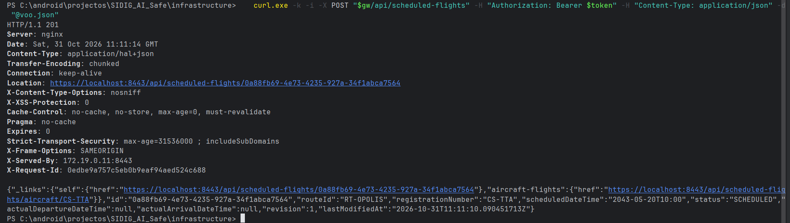
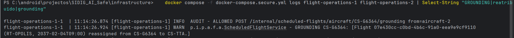

# AISafe – Flight Operations Service

Serviço do sistema distribuído **AISafe Flight Management System** (Assignment 1) responsável pelo
agendamento de voos, pela atribuição de aviões a rotas (com restrições de alcance e capacidade), pela consulta de
disponibilidade, pelo ciclo de vida dos voos, pela **reatribuição de voos quando um avião é imobilizado (grounding)** e
pelo relatório de utilização de rotas.

O serviço corre em **2 a 3 réplicas** (3 no Modo A, no IntelliJ; 2 no Docker), cada uma com a sua própria base de
dados. Os voos são **replicados** entre réplicas (consistência eventual): a criação e a mudança de estado esperam a
confirmação de **pelo menos um par** antes de responder, e as restantes cópias seguem em segundo plano. Quando uma
réplica ainda não tem os dados pedidos, consulta as outras (*forwarding peer-to-peer*) e agrega as respostas. Os
clientes entram pela **API Gateway (NGINX)** e autenticam-se no **Keycloak**. Cada réplica valida o JWT e aplica as
regras de acesso por perfil (**RBAC**). Toda a comunicação usa **HTTPS**.

---

## Início rápido (Modo B – Docker seguro)

Requisitos: Docker Desktop. A partir da raiz do repositório (PowerShell):

```powershell
cd infrastructure\docker
.\gen-certs.ps1          # uma vez: cria o .env (segredos aleatórios) e os certificados
cd ..
docker compose -f docker-compose.secure.yml up --build
```

Quando todos os containers estiverem `healthy`, o sistema fica disponível em `https://localhost:8443` (gateway 1) e
`https://localhost:8444` (gateway 2). Para testar, importar a coleção `tests(postman)/SIDIS – Modo B (Docker).postman_collection.json` e o
environment `SIDIS` (secção 9.2). Outros modos de execução: secção 4.

---

## 1. Arquitetura

| Componente                                  | Responsabilidade                                                                                                                                                |
|---------------------------------------------|-----------------------------------------------------------------------------------------------------------------------------------------------------------------|
| `ScheduledFlightController`                 | API pública (`/api/scheduled-flights`). Leituras distribuídas, respostas HATEOAS, auditoria das escritas                                                        |
| `InternalScheduledFlightController`         | API interna (`/internal/scheduled-flights`), usada **apenas** entre réplicas e pelo serviço Aircraft. Responde só com dados locais e **nunca reencaminha**      |
| `ScheduledFlightService`                    | Orquestração: local vs distribuído, agregação, AP/CP, replicação, sincronização no arranque, lock por avião, **grounding** (`groundAircraft`)                   |
| `ScheduledFlight` + value objects           | Agregado: `FlightId` (UUID), `RouteId`, `RegistrationNumber`, máquina de estados `FlightStatus`, `revision` para convergência, `reassignAircraft()`             |
| `FlightSchedulingPolicy`                    | Domain service: rota ativa, avião `ACTIVE`, alcance, capacidade, conflitos de horário (2 h)                                                                     |
| `FlightAssignmentValidator`                 | Obtém a rota e o avião dos outros serviços e traduz o JSON (`RouteInfo` / `AircraftInfo`, *Anti-Corruption Layer*)                                              |
| `FlightReplicator`                          | Replicação dos voos: o primeiro par confirma antes da resposta (`replicateAcknowledged`), os restantes em segundo plano; cópias pendentes reenviadas a cada 5 s |
| `PeerClient`                                | Comunicação com as outras réplicas **em paralelo** (`findFirst`, `collectAll`, `forwardPut`)                                                                    |
| `ReplicatedServiceClient`                   | Cliente para os outros serviços: round-robin + failover entre réplicas                                                                                          |
| `RemoteCaller` + `CircuitBreaker`           | Timeouts, retry com backoff exponencial e circuit breaker por destino                                                                                           |
| `HttpClientConfig`                          | `RestTemplate` HTTPS: envia `X-API-Key` e `X-Origin-Instance` e **reencaminha o JWT** do utilizador aos outros serviços                                         |
| `JwtAuthenticationFilter` + `TokenDecoders` | Valida o JWT: **RS256 do Keycloak** (chave pública via JWKS, emissor, expiração) ou HS256 de desenvolvimento                                                    |
| `SecurityConfig`                            | Regras RBAC por endpoint e método, sem sessão, *deny by default*                                                                                                |
| `SecurityProblemHandler`                    | Respostas 401 / 403 em `ProblemDetail` e registo `DENIED` na auditoria                                                                                          |
| `ApiKeyFilter`                              | Exige `X-API-Key` em `/internal/**` e regista cada acesso (logger `AUDIT`)                                                                                      |
| `AuditLog`                                  | Regista quem criou ou alterou cada voo                                                                                                                          |
| `GlobalExceptionHandler`                    | Traduz exceções para códigos HTTP (`ProblemDetail`)                                                                                                             |

Infraestrutura comum (pasta `infrastructure/` na raiz do repositório): **API Gateway NGINX** (`https://localhost:8443`)
e **Keycloak** (`http://localhost:8180`, realm `aisafe`) no Modo A; no Docker há duas gateways (8443 e 8444) e dois
nós Keycloak. Ver `infrastructure/README.md`.

Serviços com que este serviço colabora:

| Serviço            | Portas (Modo A)  | Utilização                                                                                           |
|--------------------|------------------|------------------------------------------------------------------------------------------------------|
| Airports & Routes  | 8091–8093        | Valida a rota (ativa, capacidade mínima)                                                             |
| Aircraft           | 8071–8073        | Valida o avião (`GET /api/aircraft/{reg}`: estado, alcance, capacidade) e dispara o grounding        |
| Maintenance        | 8075–8077        | Não é chamado diretamente; atualiza o estado do avião no Aircraft, que o FO consulta                 |

No Docker cada serviço tem 2 réplicas (ver secção 4.6).

Diagramas (pasta `docs/` deste serviço):
- `c4-component-flight-operations`: C4 nível 3 deste serviço
- `class-diagram-flight-operations`: modelo de domínio
- `sd-schedule-flight`: agendamento de ponta a ponta (login → gateway → validação → replicação)
- `sd-replication`: replicação com confirmação, reenvio e sincronização no arranque
- `sd-change-flight-status`: mudança de estado (local primeiro, reencaminhamento se faltar a cópia)
- `sd-route-utilization`: US229, agregação sem duplicados e resposta parcial
- `sd-get-flight-forwarding`: leitura com forwarding (200, 404 e 503)
- `sd-check-availability`: disponibilidade de um avião
- `sd-aircraft-grounding`: reatribuição de voos

Os C4 de contexto e de contentores e as vistas físicas estão em `docs/SIDIS`.

---

## 2. Pré-requisitos

- JDK 17 ou superior (o projeto compila com Java 17; foi testado com o JDK 25) e Maven (ou IntelliJ IDEA)
- **Keycloak** e **NGINX** a correr (ver `infrastructure/README.md`). O Keycloak exige Java 21 ou superior
- Certificado de desenvolvimento do grupo (`keystore.p12`) e a respetiva truststore (secção 4.1)
- Serviços **Airports & Routes** e **Aircraft** a correr (secção 4.2). O Maintenance só é necessário para o fluxo de
  manutenção completo
- Postman (testes distribuídos)
- Para o Modo Docker: Docker Desktop (secção 4.6)

---

## 3. Configuração

Tudo em `src/main/resources/application.properties`, alterável por **variáveis de ambiente** (sem valores fixos no código).

| Variável                                                 | Omissão                                                                | Descrição                                                                    |
|----------------------------------------------------------|------------------------------------------------------------------------|------------------------------------------------------------------------------|
| `PORT`                                                   | `8081`                                                                 | Porta da réplica                                                             |
| `INSTANCE_ID`                                            | `fo-1`                                                                 | Identificador da réplica (logs e nome da BD)                                 |
| `PEERS`                                                  | *(vazio)*                                                              | URLs **HTTPS** das **outras** réplicas, separadas por vírgulas               |
| `ROUTES_URLS`                                            | `https://localhost:8091,https://localhost:8092,https://localhost:8093` | Réplicas do Airports & Routes Service                                        |
| `AIRCRAFT_URLS`                                          | `https://localhost:8071,https://localhost:8072,https://localhost:8073` | Réplicas do Aircraft Service                                                 |
| `JWT_JWK_SET_URI`                                        | `http://localhost:8180/realms/aisafe/protocol/openid-connect/certs`    | Chave pública do Keycloak usada para validar os tokens                       |
| `JWT_ISSUER`                                             | `http://localhost:8180/realms/aisafe`                                  | Emissor esperado no token (`iss`)                                            |
| `ACCEPT_DEV_TOKENS`                                      | `true`                                                                 | Aceita tokens HS256 de desenvolvimento; **`false` em produção**              |
| `JWT_SECRET`                                             | `change-this-development-secret-key-with-at-least-32-bytes`            | Segredo dos tokens HS256 de desenvolvimento (JUnit, `DevTokenGenerator`)     |
| `API_KEY`                                                | `sidis-dev-key`                                                        | Chave partilhada entre réplicas e com o Aircraft (`/internal/**`)            |
| `SSL_ENABLED` / `SSL_KEYSTORE` / `SSL_KEYSTORE_PASSWORD` | `true` / `classpath:keystore.p12` / `password`                         | HTTPS da réplica                                                             |
| `REPLICATION_ENABLED`                                    | `true`                                                                 | `false`: cada voo fica só na réplica onde foi criado (demonstrar forwarding) |
| `REQUIRE_COMPLETE_CONFLICT_CHECK`                        | `false`                                                                | `false` = AP (aceita com aviso); `true` = CP (recusa com 503)                |

Os valores por omissão são só de desenvolvimento. No Modo Docker, `API_KEY`, `JWT_SECRET` e a palavra-passe do
keystore vêm de um `.env` gerado com valores aleatórios e fora do Git.

Outras propriedades:

| Propriedade                                  | Valor         | Descrição                                                   |
|----------------------------------------------|---------------|-------------------------------------------------------------|
| `app.http.connect-timeout` / `read-timeout`  | `1s` / `2s`   | Timeouts das chamadas remotas                               |
| `app.http.max-attempts` / `initial-backoff`  | `2` / `200ms` | Retry com backoff exponencial                               |
| `app.http.circuit-breaker.failure-threshold` | `3`           | Falhas seguidas até o circuito abrir                        |
| `app.http.circuit-breaker.open-duration`     | `10s`         | Tempo com o circuito aberto                                 |
| `app.replication.retry-interval`             | `5s`          | Reenvio das cópias a réplicas que estavam em baixo          |
| `app.scheduling.min-gap-hours`               | `2`           | Intervalo mínimo entre voos do mesmo avião                  |
| `app.security.jwt.jwk-set-uri` / `issuer`    | ver acima     | Configuração do Keycloak (`JWT_JWK_SET_URI`, `JWT_ISSUER`)  |
| `app.security.jwt.accept-dev-tokens`         | `true`        | Tokens HS256 de desenvolvimento (`ACCEPT_DEV_TOKENS`)       |

---

## 4. Como executar

Há três modos (ver `infrastructure/README.md`): **Modo A** (serviços no IntelliJ, secções 4.1 a 4.5), **Modo B**
(Docker seguro, `docker-compose.secure.yml`, secção 4.6) e **Modo C** (só os serviços em Docker,
`docker-compose.services.yml`, sem gateway nem Keycloak). Não correr dois modos ao mesmo tempo.

### 4.1 Certificados (uma vez só)

Copiar o `keystore.p12` do grupo para `src/main/resources/` e para a pasta `certs/` do serviço. Na pasta `certs/`:

```powershell
keytool -exportcert -alias aisafe-key -keystore keystore.p12 -storetype PKCS12 -storepass password -file aisafe.crt
keytool -importcert -alias aisafe -file aisafe.crt -keystore truststore.p12 -storetype PKCS12 -storepass password -noprompt
```

**Os ficheiros de `certs/` não são submetidos para o repositório.**

### 4.2 Infraestrutura e serviços externos

Ordem de arranque:

1. Keycloak e gateway: `cd infrastructure` → `.\start-infra.ps1`
   (o Keycloak precisa de Java 21+: `$env:JAVA_HOME = "<caminho do JDK 21+>"` antes de arrancar)
2. **Airports & Routes** (portas 8091–8093). Com uma só réplica, usar o *Program argument* `--peer.urls=`
3. **Aircraft** (portas 8071–8073). No arranque cria o modelo A320 e os aviões `CS-TTA` (`ACTIVE`, 180 lugares),
   `CS-TTB` (`ACTIVE`, 120 lugares) e `CS-TTM` (`UNDER_MAINTENANCE`, 180 lugares)
4. **Maintenance** (portas 8075–8077)
5. As 3 réplicas do Flight Operations (secção 4.3)

Todos os serviços usam o mesmo `keystore.p12` e as mesmas VM options da truststore.

### 4.3 Três réplicas no IntelliJ

Três *Run Configurations* de `FlightOperationsApplication`.

**VM options** (iguais nas três):
```
-Djavax.net.ssl.trustStore="<pasta do serviço>\certs\truststore.p12" -Djavax.net.ssl.trustStorePassword=password -Djavax.net.ssl.trustStoreType=PKCS12
```

| Réplica | Environment variables                                                            |
|---------|----------------------------------------------------------------------------------|
| FO-1    | `PORT=8081;INSTANCE_ID=fo-1;PEERS=https://localhost:8082,https://localhost:8083` |
| FO-2    | `PORT=8082;INSTANCE_ID=fo-2;PEERS=https://localhost:8081,https://localhost:8083` |
| FO-3    | `PORT=8083;INSTANCE_ID=fo-3;PEERS=https://localhost:8081,https://localhost:8082` |

### 4.4 Verificar

- No log de cada réplica:
    - `Tomcat started on port 808x (https)`;
    - `Replicacao ATIVA`;
    - `Peers configurados: [...]`;
    - `JWT: Keycloak RS256 = http://localhost:8180/...`.
- `GET https://localhost:808x/actuator/health` (direto, sem token) devolve `"status": "UP"`.

### 4.5 Usar a API através da gateway (PowerShell)

```powershell
$gw = "https://localhost:8443"
$token = (curl.exe -k -s -X POST "$gw/realms/aisafe/protocol/openid-connect/token" `
  -d "grant_type=password&client_id=aisafe-client&username=atcc.user&password=atcc123" | ConvertFrom-Json).access_token
'{"routeId":"RT-OPOLIS","registrationNumber":"CS-TTA","scheduledDateTime":"2027-03-15T10:00:00"}' | Out-File -Encoding ascii voo.json
curl.exe -k -i -X POST "$gw/api/scheduled-flights" -H "Authorization: Bearer $token" -H "Content-Type: application/json" -d "@voo.json"
```

Utilizadores de teste (realm `aisafe`):

| Utilizador      | Password      | Perfil                 |
|-----------------|---------------|------------------------|
| admin.user      | admin123      | ADMIN                  |
| atcc.user       | atcc123       | ATCC                   |
| backoffice.user | backoffice123 | BACKOFFICE             |
| tech.user       | tech123       | MAINTENANCE_TECHNICIAN |
| supervisor.user | supervisor123 | MAINTENANCE_SUPERVISOR |

Utilizadores e passwords do realm de teste, só para desenvolvimento.

Para testar sem Keycloak, `src/test/java/.../DevTokenGenerator.java` gera tokens HS256 de desenvolvimento
(aceites só com `ACCEPT_DEV_TOKENS=true`).

Exemplo de execução (Modo B):





As restantes capturas (arranque, RBAC, replicação, falhas e testes) estão em `infrastructure/README.md`.

### 4.6 Modo B – Docker seguro

Stack completa em containers, com 2 réplicas de cada serviço, 2 gateways e Keycloak em 2 nós:

```powershell
cd infrastructure\docker
.\gen-certs.ps1          # uma vez: cria o .env (segredos aleatórios) e os certificados
cd ..
docker compose -f docker-compose.secure.yml up --build
```

Antes de arrancar, **parar o Modo A** (incluindo o NGINX e o Keycloak locais): ambos usam as portas 8443 e 8180.

Entrada: `https://localhost:8443` (gateway 1) ou `https://localhost:8444` (gateway 2). O FO corre em `flight-operations-1`
e `flight-operations-2`, que se conhecem como pares pelo nome do container. Parar: `docker compose -f
docker-compose.secure.yml down`. Depois de reconstruir ou recriar serviços, reiniciar as gateways (o NGINX guarda os IPs
no arranque). Pormenores em `infrastructure/README.md`.

---

## 5. API

### 5.1 Pública – `/api/scheduled-flights` (exige `Authorization: Bearer <JWT>`)

| Método  | Endpoint                                      | Descrição                                                                    | Perfis                  | Respostas                         |
|---------|-----------------------------------------------|------------------------------------------------------------------------------|-------------------------|-----------------------------------|
| `POST`  | `/`                                           | US212 – agenda um voo (`routeId`, `registrationNumber`, `scheduledDateTime`) | ATCC, ADMIN             | 201, 400, 401, 403, 409, 502, 503 |
| `GET`   | `/{id}`                                       | Voo por id (cópia local ou via peers)                                        | ATCC, BACKOFFICE, ADMIN | 200, 400, 401, 403, 404, 503      |
| `PATCH` | `/{id}/status`                                | Muda o estado (`{"status": "DELAYED"}`), em qualquer réplica                 | ATCC, ADMIN             | 200, 400, 401, 403, 404, 409      |
| `GET`   | `/aircraft/{registrationNumber}`              | US213 – voos de um avião, agregados de todas as réplicas                     | ATCC, ADMIN             | 200, 204, 401, 403                |
| `GET`   | `/availability?registrationNumber=&dateTime=` | US205 – disponibilidade de um avião numa data/hora                           | ATCC, ADMIN             | 200, 400, 401, 403                |
| `GET`   | `/route-utilization`                          | US229 – rotas mais voadas, sem contar cópias repetidas                       | BACKOFFICE, ADMIN       | 200, 204, 401, 403                |

- Qualquer endpoint não previsto é negado (*deny by default*).
- **401**: sem token, token inválido, forjado ou expirado. **403**: perfil sem permissão. Ambos em `ProblemDetail`.
- As respostas agregadas e os agendamentos incluem `X-Partial-Response-Unreachable-Peers` quando alguma réplica não
  respondeu.
- Através da gateway, os links HATEOAS e o `Location` apontam para o endereço da gateway (`https://localhost:8443`).

### 5.2 Interna – `/internal/scheduled-flights` (exige `X-API-Key`, sem JWT; bloqueada na gateway; nunca reencaminha)

| Método | Endpoint                                   | Descrição                                                                                                       |
|--------|--------------------------------------------|-----------------------------------------------------------------------------------------------------------------|
| `GET`  | `/`                                        | Todos os voos locais (sincronização no arranque e US229)                                                        |
| `GET`  | `/{id}`                                    | Voo local                                                                                                       |
| `PUT`  | `/{id}/status`                             | Mudança de estado local (forwarding de escrita), depois replicada                                               |
| `PUT`  | `/{id}/replica`                            | Recebe a cópia de um voo enviada por outra réplica (idempotente)                                                |
| `GET`  | `/aircraft/{registrationNumber}`           | Voos locais de um avião                                                                                         |
| `GET`  | `/route-utilization`                       | Contagens locais por rota                                                                                       |
| `POST` | `/aircraft/{registrationNumber}/grounding` | **Grounding:** reatribui os voos futuros do avião a um dos candidatos (secção 5.4); devolve o relatório em JSON |

### 5.3 Ciclo de vida do voo

```
SCHEDULED → DELAYED | IN_FLIGHT | CANCELED
DELAYED   → IN_FLIGHT | CANCELED
IN_FLIGHT → COMPLETED
COMPLETED, CANCELED → estados finais (um voo cancelado deixa de ocupar o avião)
```

### 5.4 Grounding (reatribuição de aviões)

Quando um avião fica imobilizado (por exemplo, entra em manutenção), os voos futuros que lhe estavam atribuídos têm de
passar para outro avião. O serviço Aircraft chama o endpoint interno de grounding do Flight Operations (tenta as
réplicas do FO por ordem e fica com a primeira que responder):

```
POST /internal/scheduled-flights/aircraft/{registrationNumber}/grounding
X-API-Key: <API_KEY>
Content-Type: application/json

{ "candidateRegistrationNumbers": ["CS-TTA", "CS-TTB"] }
```

Regras:

- Só são reatribuídos os voos **futuros** em estado `SCHEDULED` ou `DELAYED`. Voos `IN_FLIGHT`, `COMPLETED`,
  `CANCELED` ou já passados não são alterados.
- A lista de candidatos é limpa: ignora valores vazios, repetidos e o próprio avião imobilizado.
- Cada voo passa para o **primeiro candidato livre**, isto é, o primeiro sem conflito de horário (intervalo de 2 h) com
  os voos desse candidato, vistos em todas as réplicas. Se nenhum estiver livre, o voo **mantém o avião imobilizado** e
  isso fica no relatório.
- A troca é feita na cópia local da réplica que recebeu o pedido e incrementa a `revision`
  (`ScheduledFlight.reassignAircraft()`), pelo que é replicada às outras réplicas, em segundo plano, como qualquer outra
  alteração. A fusão de cópias (`mergeReplica`) copia também o avião. Se o voo ainda não estiver guardado nessa réplica
  (replicação em atraso ou desligada), não é reatribuído e o relatório di-lo.
- O endpoint pertence à API interna: exige `X-API-Key`, responde apenas com os dados da réplica e nunca reencaminha, e a
  gateway bloqueia-o (403).

Resposta do FO: `200` com um **array JSON de frases**, uma por voo afetado (ou uma só, se não houver voos futuros):

```json
[
  "Flight 3ea741e6-... (RT-OPOLIS, 2027-03-15T20:00) reassigned from CS-TTB to CS-TTA.",
  "Flight 91c0b7aa-... (RT-LISLHR, 2027-03-16T09:00) kept on CS-TTB: no candidate aircraft is free at that time."
]
```

O Aircraft **não reencaminha** este relatório ao utilizador: responde com o seu próprio objeto
(`{"aircraft": ..., "swapReport": ["Flights service notified"]}`). O relatório detalhado vê-se nos logs do FO e
chamando o endpoint interno diretamente.

Fluxo ponta a ponta: o ATCC ou ADMIN muda o estado do avião no Aircraft
(`PATCH /api/aircraft-models/instances/{registo}/status`) e, se o avião deixou de estar `ACTIVE`, o Aircraft chama este
endpoint no FO. No log do FO aparecem `ALLOWED POST /internal/.../grounding` e `GROUNDING <avião>: [...]`, com uma frase por
voo afetado (por exemplo, `Flight <id> (RT-OPOLIS, 2037-02-04T09:00) reassigned from CS-G6364 to CS-TTA.`).

Limitações do grounding: só verifica **conflitos de horário** no candidato. A capacidade e o alcance da rota não são
revalidados, pelo que a escolha de candidatos adequados (mesmo modelo, `ACTIVE`, lugares suficientes) é
responsabilidade do Aircraft.

---

## 6. Decisões de arquitetura

1. **Base de dados por réplica, com replicação e confirmação por um par.** O voo é gravado na réplica que recebe o
   pedido. Antes de responder, a réplica envia a cópia (`PUT /internal/.../replica`) a um par e espera a confirmação;
   as restantes cópias seguem em segundo plano. Se nenhum par confirmar, o voo é aceite na mesma (AP), fica registado um
   aviso e a cópia fica em fila. Cópias de peers em baixo são reenviadas a cada 5 s. Assim, um voo confirmado já existe
   em duas réplicas e sobrevive à perda da réplica de origem.
2. **Convergência por versão (*last writer wins*).** Cada voo tem uma `revision`, incrementada em cada mudança de
   estado ou de avião. Uma réplica só aplica cópias mais recentes (em empate, ganha o `lastModifiedAt` mais recente).
3. **Sincronização no arranque.** Uma réplica que reinicia vai buscar os voos às outras.
4. **`FlightId` UUID gerado no domínio**, único entre réplicas sem coordenação.
5. **API interna que nunca reencaminha.** Os peers chamam sempre `/internal/**` e o `/replica` nunca volta a propagar.
   Isto impede, por construção, ciclos de forwarding e de replicação.
6. **Forwarding peer-to-peer como complemento da replicação**, em paralelo (o tempo de resposta é o do peer mais lento).
7. **Resiliência:** timeouts, retry com backoff, circuit breaker por destino, failover entre réplicas dos outros
   serviços e failover na gateway.
8. **CAP: AP, como pede o enunciado.**
    - Leituras e agendamentos respondem mesmo com réplicas em baixo e avisam o cliente.
    - Um conflito raro entre réplicas é detetado quando convergem (`CONFLITO detetado apos replicacao`).
    - Com `REQUIRE_COMPLETE_CONFLICT_CHECK=true`, o agendamento passa a CP.
9. **Segurança em camadas.** A gateway é o único ponto de entrada, mas **cada réplica valida o token e aplica o RBAC**
   (defesa em profundidade): mesmo um pedido direto a uma réplica é autenticado e autorizado.
10. **DDD.** Referências a rotas e aviões só por identidade, regras no domínio e *Anti-Corruption Layer* para os
    modelos externos.
11. **Grounding no agregado.** A mudança de avião é uma operação do próprio `ScheduledFlight` (`reassignAircraft()`),
    que valida o estado e incrementa a revisão. Assim a alteração segue o mesmo caminho de replicação e convergência
    das mudanças de estado, sem mecanismos especiais.

---

## 7. Tolerância a falhas

| Cenário                                                        | Comportamento                                                                                                                                                            |
|----------------------------------------------------------------|--------------------------------------------------------------------------------------------------------------------------------------------------------------------------|
| Uma réplica FO em baixo (pedido pela gateway)                  | A gateway tenta a seguinte (failover) e salta-a durante 10 s                                                                                                             |
| Voo ainda não replicado para esta réplica                      | Forwarding em paralelo; 404 só se **todos** responderem que não existe                                                                                                   |
| Voo não encontrado e algum peer sem resposta                   | 503: o voo pode existir nessa réplica (nunca um 404 falso)                                                                                                               |
| Réplica onde o voo foi criado em baixo                         | As outras têm a cópia: o voo continua disponível                                                                                                                         |
| Uma réplica em baixo (leitura agregada)                        | Resposta com os restantes dados + header de resposta parcial                                                                                                             |
| Uma réplica em baixo (agendamento)                             | AP: 201 com header de resposta parcial; a cópia é entregue quando ela voltar                                                                                             |
| Nenhum par confirma a cópia (agendamento ou mudança de estado) | AP: o voo é aceite, fica um aviso no log e a cópia em fila para nova tentativa                                                                                           |
| Réplica reinicia (BD em memória vazia)                         | Sincronização no arranque com as outras réplicas                                                                                                                         |
| Réplica falha repetidamente                                    | Circuit breaker: deixa de ser contactada durante 10 s                                                                                                                    |
| Uma réplica de outro serviço em baixo                          | Failover para a seguinte                                                                                                                                                 |
| Todas as réplicas de outro serviço em baixo                    | Agendamento → 503; disponibilidade → 200 com `available: false` e o motivo                                                                                               |
| Dois pedidos simultâneos para o mesmo avião (mesma réplica)    | Lock por avião: só um é aceite, o outro recebe 409                                                                                                                       |
| Conflito entre réplicas diferentes durante uma partição        | Ambos aceites (AP); conflito detetado e registado quando convergem                                                                                                       |
| Alterações concorrentes ao mesmo voo em réplicas diferentes    | Convergem para a mais recente (`revision`, `lastModifiedAt`)                                                                                                             |
| Grounding aplicado numa réplica                                | A revisão incrementada e o novo avião são replicados às outras réplicas                                                                                                  |
| Uma gateway ou um nó Keycloak em baixo (Modo Docker)           | O cliente usa a outra gateway (8444); o outro nó Keycloak continua a emitir tokens                                                                                       |
| Os dois nós Keycloak em baixo                                  | Tokens já emitidos continuam válidos nas réplicas com as chaves em cache; novos logins falham                                                                            |
| Réplica reiniciada com o Keycloak em baixo                     | Sem chaves em cache, recusa os tokens (401) até o Keycloak voltar                                                                                                        |
| Réplica de outro serviço reiniciada com o Keycloak em baixo    | O FO devolve 502 («Downstream service rejected the request: 401»): essa réplica não tem chaves em cache e recusa o JWT reencaminhado. Resolve-se quando o Keycloak volta |

---

## 8. Segurança

Perfis do AISafe: **Admin, Backoffice, ATCC, Maintenance Technician, Maintenance Supervisor**.

- **Autenticação (Keycloak):**
    - o utilizador faz login no Keycloak através da gateway e recebe um **JWT assinado com RS256**;
    - cada réplica valida a assinatura com a **chave pública do realm** (JWKS, atualizada automaticamente), o emissor e
      a expiração;
    - o utilizador e os perfis vêm do próprio token (`roles` ou `realm_access.roles`);
    - não há sessão no servidor;
    - são recusados (401) os tokens em falta, expirados, sem assinatura (`alg: none`), com o conteúdo alterado ou
      assinados com outra chave.
- **Autorização (RBAC):** regras por endpoint e método (tabela 5.1); tudo o resto é negado.
- **Gateway:**
    - ponto de entrada único por gateway, em HTTPS;
    - bloqueia `/internal/**`, `/actuator/**` e `/h2-console/**`;
    - responde 404 a caminhos sem serviço;
    - aplica rate limiting (10 pedidos/s por IP, burst 20 → 429).
- **Proteção do canal (TLS):** HTTPS em todas as ligações (cliente → gateway → réplicas → outros serviços). A gateway
  valida o certificado das réplicas e as réplicas usam a truststore do grupo.
- **Propagação da identidade:** o JWT do utilizador é reencaminhado nas chamadas aos outros serviços, que aplicam as
  suas próprias regras.
- **Entre réplicas e com o Aircraft:** header `X-API-Key` em `/internal/**`, comparado em tempo constante. Inclui o
  endpoint de grounding.
- **Auditoria (logger `AUDIT`):**
    - operações: `User: atcc.user - Action: CREATE - Target ID: <id>` (também `UPDATE_STATUS ...`);
    - acessos negados: `DENIED 401 ... reason=...` e `DENIED 403 ... user=... roles=[...]`;
    - API interna: `ALLOWED` / `DENIED` com a réplica de origem;
    - os tokens nunca são escritos nos logs.
- **Erros sem detalhes internos:** `ProblemDetail` normalizado.
- **Dados em repouso:** a base de dados é H2 em memória, pelo que não é persistido nada em disco.

---

## 9. Testes

### 9.1 JUnit – 79 testes

`src/test/java`:
- **domínio:** value objects, máquina de estados, agregado, regras de agendamento e fusão de cópias (`ReplicaMergeTest`);
- **grounding:** `AircraftReassignmentTest` (reatribuição só em `SCHEDULED`/`DELAYED`, incremento da revisão);
- **infraestrutura:**
    - circuit breaker;
    - `PeerClient` (paralelismo, peers em falha, resposta parcial, 503 em vez de 404);
    - `FlightReplicator` (envio, cópias pendentes, replicação desligada, confirmação por pelo menos um par e caso em que
      nenhum par confirma);
- **segurança:**
    - `JwtAuthenticationFilterTest`: tokens do Keycloak RS256 (chave errada, outro emissor) e HS256 de desenvolvimento
      (assinatura, expiração, sem utilizador, modo de produção);
    - `SecurityRulesTest`: regras RBAC com o Spring Security real;
    - `HttpClientConfigTest`: propagação do JWT e da API key.

Executar: botão direito em `src/test/java` → **Run 'All Tests'**, ou `mvn test`.


### 9.2 Postman – coleções `SIDIS – Modo A (IntelliJ)` e `SIDIS – Modo B (Docker)`

Pasta `tests(postman)/` da raiz do repositório:

| Ficheiro                               | Para                                                       |
|----------------------------------------|------------------------------------------------------------|
| `SIDIS – Modo A (IntelliJ).postman_collection.json` | Modo A (IntelliJ): inclui acesso direto às réplicas        |
| `SIDIS – Modo B (Docker).postman_collection.json` | Modo B (Docker seguro): só através das gateways            |

Os tokens do Keycloak são obtidos e renovados automaticamente, e cada execução gera um `runId` e datas novas, pelo que as
coleções podem repetir-se sem limpar as bases de dados. Pastas com testes deste serviço:

| Pasta | Conteúdo                                                                                                                      |
|-------|-------------------------------------------------------------------------------------------------------------------------------|
| 00    | Login dos 5 perfis e arranque                                                                                                 |
| 02    | Autenticação: sem token, mal formado, forjado, `alg: none`, expirado, outro segredo                                           |
| 03    | RBAC: 15 endpoints (FO, Aircraft e Maintenance) × 5 perfis                                                                    |
| 04    | Regras de negócio do FO: conflitos de 2 h, capacidade, rota inativa, validações, disponibilidade, ciclo de vida, US229        |
| 05    | Replicação e P2P (Modo A: acesso direto às 3 réplicas; Modo B: através da gateway, 2 réplicas)                                |
| 07    | Ponta a ponta entre 3 serviços: agendar, imobilizar o avião (grounding), reatribuir o voo, registar e concluir uma manutenção |
| 09    | **Manual:** tolerância a falhas (Modo A: 15 pedidos; Modo B: 13 pedidos)                                                      |

Executar:
1. Importar o environment e a coleção do modo em uso, e escolher o environment `SIDIS`.
2. Em **Settings → General**, desligar **SSL certificate verification**.
3. Abrir o **Collection Runner**, selecionar as pastas **00 a 07** e pôr **Delay 100 ms** (a gateway limita a 10 pedidos/s).
4. A pasta 09 corre-se pedido a pedido, não no Runner: o nome de cada pedido diz o que parar ou ligar antes.
   No Modo A, os pedidos `09.09` a `09.15` são opcionais e exigem reiniciar o FO com variáveis de ambiente específicas
   (replicação desligada, modo CP). No Modo B, a pasta 09 usa só `docker compose stop/start`.

Antes de correr, confirmar que todas as instâncias estão `UP` e que o outro modo está parado. A lista completa dos
pedidos 09 do Modo B e as respostas esperadas estão em `infrastructure/README.md`.

---

## 10. Limitações conhecidas e trabalho futuro

| Limitação                                                       | Impacto                                                                                                                                                 | Trabalho futuro                                           |
|-----------------------------------------------------------------|---------------------------------------------------------------------------------------------------------------------------------------------------------|-----------------------------------------------------------|
| Conflitos entre réplicas durante uma partição (AP)              | Dois voos do mesmo avião podem ser aceites; detetados, mas não resolvidos                                                                               | Particionar agendamentos por matrícula ou quórum          |
| *Last writer wins*                                              | Em alterações concorrentes ao mesmo voo, uma perde-se                                                                                                   | Relógios vetoriais ou resolução no domínio                |
| Grounding sem candidato livre                                   | O voo mantém o avião imobilizado (fica no relatório)                                                                                                    | Notificar o operador / cancelar o voo de forma controlada |
| Grounding só valida conflitos de horário                        | Um candidato com menos lugares ou alcance pode receber um voo que não cumpre a rota                                                                     | Revalidar rota e capacidade do candidato na reatribuição  |
| BDs H2 em memória                                               | Mitigado pela sincronização; se todas as réplicas reiniciarem, os dados perdem-se                                                                       | Base de dados persistente (com cifra em repouso)          |
| Cópias pendentes em memória                                     | Mitigado: o primeiro par confirma antes da resposta. Se a origem e esse par falharem antes de entregar às restantes, a cópia só chega por sincronização | Fila persistente / broker de mensagens                    |
| Gateway e Keycloak únicos no Modo A                             | Pontos únicos de falha da infraestrutura local                                                                                                          | Usar o Modo Docker (2 gateways, 2 Keycloak)               |
| PostgreSQL do Keycloak e anfitrião Docker únicos (Modo Docker)  | Pontos únicos residuais                                                                                                                                 | Base de dados replicada e vários anfitriões               |
| Keycloak local em HTTP; tokens HS256 de desenvolvimento aceites | Adequado só a desenvolvimento                                                                                                                           | Keycloak em HTTPS; `ACCEPT_DEV_TOKENS=false`              |
| Certificado partilhado; API key estática entre réplicas         | Sem identidade própria por serviço nem rotação de chaves                                                                                                | Certificados por serviço emitidos por uma CA; mTLS        |
| `minimumRange` não exposto pelo Airports & Routes               | Regra do alcance não é verificada com o serviço real                                                                                                    | Acrescentar o campo ao `RouteViewDTO`                     |
| `X-Request-Id` da gateway não aparece nos logs do serviço       | Correlação gateway ↔ serviço feita à mão                                                                                                                | Incluir o id no MDC dos logs                              |
| Datas sem fuso horário; lista de peers estática                 | Ambiguidade entre fusos; reconfigurar para mudar réplicas                                                                                               | `OffsetDateTime`/UTC; *service discovery*                 |

---

## 11. Estrutura do projeto

```
src/main/java/pt/isep/psoft/aisafe/flight_operations/
├── api/              controllers (público e interno) e tratamento de erros
├── application/      ScheduledFlightService, FlightAssignmentValidator, DTOs
├── domain/           agregado, value objects, FlightStatus, FlightSchedulingPolicy
├── infrastructure/   PeerClient, FlightReplicator, RemoteCaller, CircuitBreaker, ReplicatedServiceClient
├── repositories/     ScheduledFlightRepository
├── security/         JwtAuthenticationFilter, TokenDecoders, SecurityProblemHandler, AuditLog, Roles
└── config/           SecurityConfig, HttpClientConfig, ApiKeyFilter, beans de domínio
src/main/resources/   application.properties, keystore.p12
src/test/java/...     testes JUnit (incl. AircraftReassignmentTest), DevTokenGenerator
docs/                 diagramas PlantUML do serviço
certs/                truststore.p12 (local, não submetido)
```