# AISafe – Flight Operations Service (Entrega 2)

Serviço do sistema distribuído **AISafe Flight Management System** responsável pelo agendamento de voos, pela
atribuição de aviões a rotas (alcance e capacidade), pela consulta de disponibilidade, pelo ciclo de vida dos voos, pela
**reatribuição de voos quando um avião é imobilizado (grounding)** e pelo relatório de utilização de rotas.

A documentação da Entrega 1 está no `README.md`. Este documento descreve a Entrega 2: CQRS, mensagens AMQP,
base de dados por réplica e infraestrutura sem pontos únicos de falha.

---

## Início rápido (Modo B – Docker seguro)

Requisitos: Docker Desktop. A partir da raiz do repositório (PowerShell):

```powershell
cd infrastructure\docker
.\gen-certs.ps1          # uma vez: cria o .env (segredos aleatórios) e os certificados
cd ..
docker compose -f docker-compose.secure.yml up -d --build
docker compose -f docker-compose.secure.yml ps -a
```

Quando todos os containers estiverem `healthy` (e o `rabbitmq-init` em `Exited (0)`), o sistema fica disponível em
`https://localhost:8443` (gateway 1) e `https://localhost:8444` (gateway 2).

O **Modo A (IntelliJ)** também funciona na Entrega 2, com 3 réplicas do FO: ver
`infrastructure/README_E2.md`, secção "Modo A (IntelliJ)". Os dois modos usam as mesmas portas e não podem correr ao
mesmo tempo.

---

## E2.1 O que mudou face à Entrega 1

| Entrega 1                                                             | Entrega 2                                                                                                  |
|-----------------------------------------------------------------------|------------------------------------------------------------------------------------------------------------|
| H2 em memória por réplica                                             | **PostgreSQL por réplica** (Database-per-Service), esquemas `fo_command` e `fo_query`, migrações Flyway    |
| `ScheduledFlightService` (leituras e escritas no mesmo modelo)        | **CQRS:** `FlightCommandService` (escritas) e `FlightQueryService` (leituras sobre vistas)                 |
| Replicação por HTTP (`FlightReplicator`, `PUT /internal/.../replica`) | **Eventos AMQP (RabbitMQ)** com *transactional outbox*; cada réplica tem a sua fila                        |
| Validação da rota e do avião por REST em cada agendamento             | **Dados de referência locais** (`route_ref`, `aircraft_ref`) atualizados por eventos; REST só como recurso |
| Forwarding peer-to-peer e respostas parciais                          | Leituras só locais (vistas), sem forwarding nem `X-Partial-Response-Unreachable-Peers`                     |
| Conflitos entre réplicas detetados, mas não resolvidos                | **Resolução determinística** com compensação (`ConflictResolver`)                                          |
| Grounding sem candidato livre: o voo mantinha o avião imobilizado     | O voo passa a `DELAYED` com o motivo `NO_REPLACEMENT_AIRCRAFT`                                             |
| Keycloak com uma só base de dados                                     | Base de dados do Keycloak com **3 nós PostgreSQL + repmgr** (failover automático)                          |
| —                                                                     | **Cluster RabbitMQ de 3 nós**, *quorum queues*, AMQPS                                                      |

Removidos: `ScheduledFlightService`, `FlightAssignmentValidator`, `FlightReplicator`, `ScheduleResultDTO` e as variáveis
`REPLICATION_ENABLED` e `REQUIRE_COMPLETE_CONFLICT_CHECK`.

## E2.2 Arquitetura (CQRS)

```
              POST / PATCH                                   GET
                   │                                          │
        ┌──────────▼──────────┐                    ┌──────────▼──────────┐
        │ FlightCommandService│                    │  FlightQueryService │
        └──────────┬──────────┘                    └──────────▲──────────┘
     1 transação   │                                          │
   ┌───────────────┼──────────────────┐                       │
   ▼               ▼                  ▼                       │
fo_command.     fo_command.      FlightProjector ──────► fo_query (vistas)
scheduled_flight outbox_event    (read-your-writes)       flight_view
                   │                                      route_utilization_view
            OutboxRelay ──► RabbitMQ (flights.events)
                                     │
                      fila desta e da outra réplica
                                     ▼
                        FlightEventListener → FlightReplicaService → FlightProjector
```

- **Lado dos comandos.** O `FlightCommandService` valida as regras no domínio (`FlightSchedulingPolicy`), grava o
  agregado `ScheduledFlight` e o evento na tabela `outbox_event` **na mesma transação**, e atualiza logo as vistas
  locais. Quem escreve numa réplica lê logo o seu próprio resultado nessa réplica.
- **Lado das consultas.** O `FlightQueryService` só lê as vistas de `fo_query` e os dados de referência locais.
  Nunca chama outras réplicas nem outros serviços.
- **Projeções.** O `FlightProjector` atualiza `flight_view` (só se a versão recebida for mais recente) e recalcula a
  utilização da rota (sem voos `CANCELED`).

| Componente                                                                                        | Responsabilidade                                                                                               |
|---------------------------------------------------------------------------------------------------|----------------------------------------------------------------------------------------------------------------|
| `ScheduledFlightController`                                                                       | API pública (mesmos URLs da P1); lê `X-Request-Id` como *correlation id*; `ETag` no `GET /{id}`                |
| `InternalScheduledFlightController`                                                               | API interna: estado completo dos voos e grounding                                                              |
| `FlightCommandService`                                                                            | Agendamento e mudança de estado (lado dos comandos)                                                            |
| `FlightQueryService`                                                                              | Consultas sobre as vistas (lado das consultas)                                                                 |
| `FlightReplicaService`                                                                            | Aplica os voos recebidos de outras réplicas (*last writer wins*) e chama o `ConflictResolver`                  |
| `ConflictResolver`                                                                                | Resolve conflitos de horário entre réplicas de forma determinística                                            |
| `GroundingService`                                                                                | Reatribui os voos futuros de um avião imobilizado                                                              |
| `FlightProjector`                                                                                 | Mantém as vistas de leitura                                                                                    |
| `ReferenceDataService`                                                                            | Mantém `route_ref` e `aircraft_ref`; recurso a REST (`ReferenceLookup`) só para referências desconhecidas      |
| `OutboxWriter` / `OutboxRelay`                                                                    | *Transactional outbox*: grava o evento com o agregado e publica-o no broker                                    |
| `AircraftReferenceService`                                                                        | Aplica os eventos do Aircraft ao `aircraft_ref` (só alterações mais recentes)                                  |
| `AircraftGroundingHandler`                                                                        | Decide o grounding: atualiza o `aircraft_ref` e chama o `GroundingService` se o avião não estiver `ACTIVE`     |
| `SnapshotBootstrapper`                                                                            | Réplica com a BD vazia: copia os voos da outra réplica no arranque (tenta até a outra responder)               |
| `MissingFlightRecovery`                                                                           | Comando sobre um voo que ainda não chegou a esta réplica: copia-o da outra réplica antes de o executar         |
| `GroundingReconciler`                                                                             | De 30 em 30 s, pede o grounding de aviões não `ACTIVE` que ainda tenham voos futuros por tratar                |
| `ProcessedEventCleanup`                                                                           | Limpa a tabela de idempotência (`processed_event`) ao fim de 7 dias                                            |
| `ReplicaSyncReconciler`                                                                           | *Anti-entropy*: de 20 em 20 s compara os voos com a outra réplica e aplica os que faltam ou estão mais antigos |
| `FlightEventListener` / `RouteEventListener` / `AircraftEventListener` / `GroundingEventListener` | Consumidores AMQP idempotentes (`IdempotencyGuard`)                                                            |
| `AirportsRoutesTranslator` / `AircraftEventTranslator`                                            | *Anti-Corruption Layer* para os eventos do Airports & Routes e do Aircraft                                     |

## E2.3 Comunicação entre serviços

As APIs externas continuam a ser **HTTP REST** (através das gateways). Entre réplicas e entre serviços, a comunicação
passa a ser **assíncrona por AMQP** (RabbitMQ).

**Eventos publicados pelo FO** (exchange `flights.events`, tipo `topic`):

| Evento                | Routing key             | Payload                                    |
|-----------------------|-------------------------|--------------------------------------------|
| `FlightScheduled`     | `flight.scheduled`      | estado completo do voo (`FlightState`)     |
| `FlightStatusChanged` | `flight.status-changed` | `{previousStatus, flight}`                 |
| `FlightReassigned`    | `flight.reassigned`     | `{fromAircraft, flight}`                   |

Envelope comum (`IntegrationEvent`): `eventId`, `type`, `version`, `occurredAt`, `aggregateId`, `revision`,
`sourceInstance`, `correlationId`, `payload`. Os eventos levam o **estado completo do voo** (*event-carried state
transfer*), pelo que cada evento basta para atualizar a cópia, sem chamadas de volta.

**Eventos consumidos pelo FO:**

| Origem            | Exchange                                      | Fila (uma por réplica)          | Uso                                                                       |
|-------------------|-----------------------------------------------|---------------------------------|---------------------------------------------------------------------------|
| Outra réplica FO  | `flights.events` (`flight.#`)                 | `fo.flights.<réplica>`          | Replicação dos voos                                                       |
| Airports & Routes | `airports.events` (fanout)                    | `fo.routes.<réplica>`           | `ROUTE_CREATED`, `ROUTE_UPDATED`, `ROUTE_DEACTIVATED` → `route_ref` (ACL) |
| Aircraft          | `aircraft.events` (`aircraft.#`)              | `fo.aircraft.<réplica>`         | Registo e alterações dos aviões → `aircraft_ref` (ACL)                    |
| Aircraft          | `aircraft.events` (`aircraft.status-changed`) | `fo.grounding` (**partilhada**) | Avião deixa de estar `ACTIVE` → grounding, feito por **uma só** réplica   |
| Flight Operations | `flights.events` (`fo.grounding.requested`)   | `fo.grounding` (**partilhada**) | Pedido explícito de grounding (`GroundingRequested`)                      |

Contrato de eventos do serviço Aircraft (exchange `aircraft.events`, tipo `topic`; routing keys `aircraft.registered`,
`aircraft.status-changed` e `aircraft.updated`):

```json
{"eventId": "...", "type": "AircraftStatusChanged", "occurredAt": "2026-11-16T10:00:00Z",
  "aggregateId": "CS-TTA", "revision": 4,
  "payload": {"registrationNumber": "CS-TTA", "modelCode": "A320", "status": "UNDER_MAINTENANCE",
    "maximumRange": 6100, "seatingCapacity": 180}}
```

O `AircraftEventTranslator` é tolerante: ignora campos desconhecidos, aceita o `payload` como texto JSON e a matrícula
só no `aggregateId`. Um evento com uma revisão antiga é ignorado, pelo que não imobiliza um avião que já voltou a
`ACTIVE`.

Padrões usados:

- ***Publish/subscribe* com uma fila por réplica.** Cada réplica recebe todos os eventos.
- ***Work queue* (*competing consumers*).** A fila `fo.grounding` é partilhada pelas duas réplicas: cada mensagem é
  processada por **uma** delas, e as reatribuições chegam à outra como eventos normais (`FlightReassigned`).
- ***Transactional outbox*.** Um evento nunca se perde se a transação foi confirmada, e nunca é publicado se a
  transação falhou. O `OutboxRelay` usa *publisher confirms* e mensagens `mandatory`. Para no primeiro envio falhado
  (preserva a ordem) e tenta de novo com backoff exponencial (até 30 s).
- **Consumidores idempotentes.** A tabela `processed_event` (chave `consumer` + `eventId`) é gravada na mesma transação
  que o efeito. A mensagem só é confirmada (*ack*) depois do *commit*. As entradas com mais de 7 dias são apagadas de
  hora a hora (`ProcessedEventCleanup`): uma mensagem é reentregue em segundos, nunca dias depois.
- ***Dead-letter*.** Todas as filas são *quorum*, com `x-delivery-limit: 5`. Uma mensagem que falha 5 vezes vai para
  `fo.dlx` → `fo.dead-letter`, para análise, sem bloquear a fila.
- **Topologia declarada antes do arranque.** O `rabbitmq-init` importa `infrastructure/rabbitmq/definitions.json`
  (exchanges, filas e *bindings*), pelo que nenhuma mensagem é publicada para uma fila que ainda não existe.

## E2.4 Modelo de consistência

- **Dentro de uma réplica:** consistência forte. O agregado e o evento são gravados na mesma transação, e a réplica
  que recebe a escrita atualiza logo as suas vistas (*read-your-writes*).
- **Entre réplicas:** **consistência eventual**. A outra réplica fica atualizada quando consome o evento (normalmente
  em menos de 1 s). Se um **comando** (`PATCH /{id}/status`) chegar a uma réplica antes do evento do voo, essa réplica
  copia o voo da outra (`GET /internal/scheduled-flights/{id}`) e executa o comando, em vez de responder 404
  (`MissingFlightRecovery`). As **leituras** continuam só locais (CQRS).
- **Convergência:** *last writer wins* por `revision`; em empate, `lastModifiedAt` e depois a ordem do estado. Eventos
  repetidos ou fora de ordem não alteram o resultado.
- ***Anti-entropy*:** se um evento se perder para uma réplica (por exemplo, foi para a *dead-letter* porque a BD dessa
  réplica estava em baixo), o `ReplicaSyncReconciler` deteta a diferença na ronda seguinte (até 20 s) e aplica o estado
  da outra réplica, com as mesmas regras de *last writer wins*. As réplicas convergem mesmo sem o evento.
- **Conflitos de horário entre réplicas** (dois voos do mesmo avião a menos de 2 h, aceites em réplicas diferentes):
  o `ConflictResolver` escolhe sempre o mesmo vencedor em todas as réplicas (o voo criado primeiro; em empate, o menor
  `flightId`). O outro é **cancelado** com o motivo `SCHEDULE_CONFLICT_WITH <id>` (compensação), e esse cancelamento é
  publicado como um evento normal.
- **CAP:** o FO é **AP**: aceita escritas com o broker ou a outra réplica em baixo, e o outbox guarda os eventos até
  poderem ser entregues. O broker, com *quorum queues*, é **CP**: só aceita mensagens com a maioria dos nós (2 de 3).

## E2.5 Infraestrutura sem pontos únicos de falha (Modo B)

| Componente           | Instâncias                                     | Comportamento com uma falha                                                                                  |
|----------------------|------------------------------------------------|--------------------------------------------------------------------------------------------------------------|
| API Gateway (NGINX)  | 2 (8443, 8444)                                 | O cliente usa a outra gateway                                                                                |
| Keycloak             | 2                                              | O outro nó continua a emitir tokens                                                                          |
| BD do Keycloak       | 3 (PostgreSQL + repmgr: 1 primário, 2 standby) | O repmgr promove um standby; o Keycloak liga-se ao novo primário (`targetServerType=primary`)                |
| RabbitMQ             | 3 (cluster, `pause_minority`)                  | As *quorum queues* continuam com 2 de 3 nós; os clientes ligam-se a outro nó                                 |
| Flight Operations    | 2, cada uma com a sua PostgreSQL               | A outra réplica continua a servir; a fila da réplica em baixo guarda os eventos                              |
| BD de uma réplica FO | 1 por réplica                                  | A réplica sem BD responde `503`; a gateway repete o pedido na outra réplica (`proxy_next_upstream http_503`) |

Todo o tráfego AMQP usa **TLS (AMQPS, porta 5671)**; a porta 5672 sem TLS está desligada.

## E2.6 Tolerância a falhas

| Cenário                                                             | Comportamento                                                                                                                                                                                                                                                                                                                                    |
|---------------------------------------------------------------------|--------------------------------------------------------------------------------------------------------------------------------------------------------------------------------------------------------------------------------------------------------------------------------------------------------------------------------------------------|
| Broker totalmente em baixo                                          | As escritas são aceites (AP); os eventos ficam no outbox e são publicados quando o broker volta                                                                                                                                                                                                                                                  |
| Um nó RabbitMQ em baixo                                             | Sem impacto: *quorum queues* com maioria; os clientes ligam-se a outro nó da lista                                                                                                                                                                                                                                                               |
| Dois nós RabbitMQ em baixo                                          | O nó restante pausa (`pause_minority`); tratado como broker em baixo (outbox)                                                                                                                                                                                                                                                                    |
| Uma réplica FO em baixo                                             | A gateway usa a outra; a fila da réplica parada acumula os eventos e ela recupera-os ao voltar                                                                                                                                                                                                                                                   |
| Mensagem repetida                                                   | Ignorada (`processed_event`)                                                                                                                                                                                                                                                                                                                     |
| Mensagem que falha sempre                                           | Ao fim de 5 entregas vai para `fo.dead-letter`; o estado do voo é reposto pela sincronização entre réplicas (`ReplicaSyncReconciler`)                                                                                                                                                                                                            |
| Airports & Routes ou Aircraft em baixo                              | O agendamento usa os dados de referência locais; só falha (503) se a rota ou o avião nunca tiverem sido vistos                                                                                                                                                                                                                                   |
| Dois pedidos simultâneos para o mesmo avião (mesma réplica)         | Lock na linha do avião (`aircraft_ref`): só um é aceite, o outro recebe 409                                                                                                                                                                                                                                                                      |
| Conflito entre réplicas                                             | Resolvido de forma determinística; o voo perdedor é cancelado (secção E2.4)                                                                                                                                                                                                                                                                      |
| Grounding sem avião livre                                           | O voo passa a `DELAYED` com o motivo `NO_REPLACEMENT_AIRCRAFT`                                                                                                                                                                                                                                                                                   |
| Primário da BD do Keycloak em baixo                                 | Failover automático (testado: promoção em menos de 45 s, novos logins continuam a funcionar)                                                                                                                                                                                                                                                     |
| Avião deixa de estar `ACTIVE` (evento do Aircraft)                  | Uma só réplica faz o grounding (fila `fo.grounding`); se ela falhar a meio, a mensagem volta à fila                                                                                                                                                                                                                                              |
| Réplica arranca com a BD vazia (disco perdido)                      | `SnapshotBootstrapper` copia os voos da outra réplica enquanto consome a sua fila; se a outra estiver em baixo, tenta até ela voltar (5 s, a duplicar até 60 s)                                                                                                                                                                                  |
| Comando sobre um voo que ainda não chegou a esta réplica            | O voo é copiado da outra réplica e o comando é executado (sem 404); se a outra não responder, 404 como antes                                                                                                                                                                                                                                     |
| Voo agendado durante o grounding (réplica ainda sem a imobilização) | O `GroundingReconciler` deteta-o (até 30 s) e publica um `GroundingRequested`; uma só réplica reatribui o voo                                                                                                                                                                                                                                    |
| BD de uma réplica em baixo (réplica a correr)                       | A réplica responde `503` + `Retry-After` em até 2 s (`GlobalExceptionHandler`, timeout do pool 2 s); a gateway repete na outra réplica, e o cliente não vê o erro. Os eventos que falharam 5 vezes nesse período vão para a *dead-letter*; ao voltar a BD, o `ReplicaSyncReconciler` repõe esses voos em até 20 s (testado: Postman 07.17/07.18) |
| Dois pedidos aprendem a mesma rota/avião ao mesmo tempo             | A cópia local é inserida numa transação própria (`ReferenceWriter`); quem perde a corrida usa a cópia já gravada (sem 500)                                                                                                                                                                                                                       |
| Disponibilidade pedida a uma réplica que ainda não conhece o avião  | A réplica pergunta uma vez ao Aircraft e responde como as outras; se o Aircraft estiver em baixo, responde `UNKNOWN`                                                                                                                                                                                                                             |
| Gateway 1 em baixo / um nó do Keycloak em baixo                     | O cliente usa a gateway 2; o outro Keycloak emite os tokens e as duas réplicas continuam a validá-los                                                                                                                                                                                                                                            |

## E2.7 API – alterações face à Entrega 1

- Os endpoints públicos de `/api/scheduled-flights` mantêm os URLs, perfis e códigos da P1. As respostas passam a
  incluir `statusReason` (por exemplo `SCHEDULE_CONFLICT_WITH <id>` ou `NO_REPLACEMENT_AIRCRAFT`).
- `GET /{id}` devolve `ETag` com a `revision`.
- Deixa de existir o header `X-Partial-Response-Unreachable-Peers`.
- API interna (`/internal/scheduled-flights`, exige `X-API-Key`, bloqueada na gateway):

| Método | Endpoint                                   | Descrição                                                                                                             |
|--------|--------------------------------------------|-----------------------------------------------------------------------------------------------------------------------|
| `GET`  | `/`                                        | Estado completo de todos os voos da réplica (`FlightState`)                                                           |
| `GET`  | `/{id}`                                    | Estado completo de um voo                                                                                             |
| `POST` | `/aircraft/{registrationNumber}/grounding` | Grounding por REST (mantido enquanto o Aircraft o usar); mesmo `GroundingService` do caminho por eventos, idempotente |

## E2.8 Configuração (novas variáveis)

| Variável                               | Omissão                                       | Descrição                               |
|----------------------------------------|-----------------------------------------------|-----------------------------------------|
| `DB_URL` / `DB_USER` / `DB_PASSWORD`   | `jdbc:postgresql://localhost:5441/flightops`  | PostgreSQL desta réplica                |
| `RABBITMQ_ADDRESSES`                   | `localhost:5672`                              | Nós do RabbitMQ, separados por vírgulas |
| `RABBITMQ_USER` / `RABBITMQ_PASSWORD`  | `aisafe` / *(dev)*                            | Credenciais do broker                   |
| `RABBITMQ_SSL`                         | `false`                                       | `true` para AMQPS (Modo B)              |

| Propriedade                                      | Valor           | Descrição                                                                                      |
|--------------------------------------------------|-----------------|------------------------------------------------------------------------------------------------|
| `app.outbox.poll-interval` / `batch-size`        | `500ms` / `100` | Frequência e tamanho de cada envio do outbox                                                   |
| `app.outbox.max-backoff`                         | `30s`           | Espera máxima entre tentativas com o broker em baixo                                           |
| `app.outbox.retention`                           | `7d`            | Tempo até apagar eventos já publicados                                                         |
| `app.bootstrap.retry-interval`                   | `5s`            | Primeiro intervalo entre tentativas do snapshot (duplica até 60 s)                             |
| `app.bootstrap.max-attempts`                     | `0`             | Tentativas do snapshot; `0` = sem limite                                                       |
| `app.grounding.reconcile-interval`               | `30s`           | Verificação de voos que ficaram em aviões imobilizados                                         |
| `app.idempotency.retention` / `cleanup-interval` | `7d` / `1h`     | Retenção e limpeza da tabela `processed_event`                                                 |
| `spring.datasource.hikari.connection-timeout`    | `2000` (ms)     | Tempo máximo à espera de uma ligação à BD; com a BD em baixo a réplica responde `503` depressa |
| `app.sync.interval`                              | `20s`           | Intervalo da sincronização entre réplicas (*anti-entropy*)                                     |

No Modo B todas as palavras-passe (BD, RabbitMQ, *Erlang cookie*, BD do Keycloak, repmgr) vêm do `.env`, gerado com
valores aleatórios pelo `gen-certs.ps1` e fora do Git.

## E2.9 Testes

**JUnit – 155 testes** (`.\mvnw.cmd test` na pasta do serviço; a base de dados de teste é H2 em modo PostgreSQL, com as
mesmas migrações Flyway). Além dos testes da P1, cobrem:

- lado dos comandos (`FlightCommandServiceTest`) e das consultas (`FlightQueryServiceTest`);
- projeções (`FlightProjectorTest`);
- replicação por eventos e resolução de conflitos (`FlightReplicaServiceTest`, `FlightEventParsingTest`);
- ACL dos eventos do Airports & Routes (`AirportsRoutesTranslatorTest`) e dados de referência (`ReferenceDataTest`);
- grounding (`GroundingServiceTest`) e eventos do Aircraft (`AircraftEventTranslatorTest`,
  `AircraftReferenceServiceTest`, `AircraftGroundingHandlerTest`);
- snapshot no arranque (`SnapshotBootstrapperTest`), cópia de um voo em falta (`MissingFlightRecoveryTest`),
  reconciliação do grounding (`GroundingReconcilerTest`) e limpeza da idempotência (`ProcessedEventCleanupTest`);
- regras RBAC dos endpoints (`SecurityRulesTest`);
- concorrência nas referências locais (`ReferenceDataServiceConcurrencyTest`), disponibilidade numa réplica que ainda
  não conhece o avião (`FlightQueryServiceAvailabilityFallbackTest`), `503` com a BD em baixo
  (`GlobalExceptionHandlerDatabaseTest`) e sincronização entre réplicas (`ReplicaSyncReconcilerTest`).

**Postman – Modo B: coleção `SIDIS – Entrega 2 Modo B (Docker)`** (`tests(postman)/SIDIS – Entrega 2 Modo B (Docker).postman_collection.json`,
environment `SIDIS`, verificação SSL desligada). As coleções da Entrega 1 mantêm-se sem alterações.

| Pasta | Tipo       | O que cobre                                                                                                                                                                                                                                                                                                                                                 |
|-------|------------|-------------------------------------------------------------------------------------------------------------------------------------------------------------------------------------------------------------------------------------------------------------------------------------------------------------------------------------------------------------|
| 00–06 | Automática | Runner com 100 ms de atraso: **111 testes, 0 falhas**                                                                                                                                                                                                                                                                                                       |
| 02    |            | Comandos e consultas do FO, convergência das duas réplicas, ETag = revisão, 8 reservas simultâneas do mesmo slot (fica um voo), evento fora de ordem ignorado, sequência rápida de comandos entre réplicas, disponibilidade                                                                                                                                 |
| 03    |            | Eventos do Airports & Routes: rota nova e rota desativada chegam ao FO                                                                                                                                                                                                                                                                                      |
| 04    |            | Eventos do Aircraft publicados pela API de gestão do RabbitMQ (grounding → voos movidos e avião `UNDER_MAINTENANCE`, duplicado, ordem por revisão, *dead-letter*)                                                                                                                                                                                           |
| 06    |            | Aircraft e Maintenance: leitura do avião `CS-TTA` e das manutenções em curso; cadeia por eventos Maintenance → Aircraft → FO (06.03): a manutenção imobiliza o avião, o FO move os voos e, ao concluir, o avião volta a `ACTIVE`                                                                                                                                                                       |
| 07    | Manual     | 18 testes: réplica do FO/Airports em baixo, broker todo em baixo (outbox), partição e compensação, um nó do broker em baixo, snapshot de uma réplica reconstruída, failover da BD do Keycloak, serviços vizinhos em baixo, recuperação total, gateway 1 em baixo, um Keycloak em baixo, BD de uma réplica do FO em baixo e recuperação — **todos passaram** |

**Postman – Modo A: coleção `SIDIS – Entrega 2 Modo A (IntelliJ)`** (`tests(postman)/SIDIS – Entrega 2 Modo A (IntelliJ).postman_collection.json`).
Os testes do FO chamam diretamente as 3 réplicas (`fo1`, `fo2`, `fo3`), à vez.

| Pasta | Tipo       | O que cobre                                                                                                                                                                                                                                                                                                  |
|-------|------------|--------------------------------------------------------------------------------------------------------------------------------------------------------------------------------------------------------------------------------------------------------------------------------------------------------------|
| 00–07 | Automática | Runner com 100 ms de atraso: **181 testes, 0 falhas** — login, saúde das 9 instâncias, eventos do Airports (incluindo detalhes e parâmetros de rotas), CQRS e convergência das 3 réplicas do FO, concorrência, evento fora de ordem, eventos do Aircraft e cadeia Maintenance → Aircraft → Flight Operations |
| 08–09 | Manual     | Réplica do FO / do Airports parada: a sua fila guarda os eventos e ela recupera-os ao voltar — **passaram**                                                                                                                                                                                                  |
| 10    | Manual     | Replicação da imagem de um aeroporto (opcional)                                                                                                                                                                                                                                                              |

Os testes da pasta 04 que publicam no RabbitMQ precisam de `rabbitMgmt` (`http://localhost:15672`), `rabbitUser` e
`rabbitPassword` (o valor do `.env`) no environment. Na pasta 07, o comando entre `[ ]` no nome de cada pedido corre-se
antes de o enviar.

## E2.10 Limitações conhecidas

| Limitação                                         | Impacto                                                                                                                                                                    | Trabalho futuro                                                                                                                         |
|---------------------------------------------------|----------------------------------------------------------------------------------------------------------------------------------------------------------------------------|-----------------------------------------------------------------------------------------------------------------------------------------|
| Um só anfitrião Docker (ambiente de demonstração) | Dentro da máquina não há pontos únicos de falha (todos os componentes têm réplicas); se a própria máquina falhar, falha tudo. Não é eliminável com um só computador físico | Docker Swarm (3 nós gestores) ou Kubernetes em 3 máquinas, com cada réplica, nó do broker e nó da BD do Keycloak numa máquina diferente |
| Imagem `bitnamilegacy/postgresql-repmgr` (fixada) | Repositório sem atualizações desde 2025                                                                                                                                    | Fork mantido `soldevelo/postgresql-repmgr`                                                                                              |
| *Last writer wins*                                | Em alterações concorrentes ao mesmo voo, uma perde-se                                                                                                                      | Resolução no domínio por tipo de alteração                                                                                              |
| Consistência eventual entre réplicas              | Logo após uma escrita, uma **leitura** na outra réplica pode ainda não ter o voo (~1 s); os comandos já não são afetados                                                   | —  (escolha consciente: AP)                                                                                                             |
| Eventos do Aircraft dependem do serviço Aircraft  | Enquanto não forem publicados, o `aircraft_ref` vem do recurso a REST e o grounding chega por REST                                                                         | Publicação dos eventos pelo Aircraft (contrato na secção E2.3)                                                                          |

## E2.11 Estrutura do projeto

```
src/main/java/pt/isep/psoft/aisafe/flight_operations/
├── api/                          controllers (público e interno), DTOs, erros
├── application/                  FlightCommandService, FlightReplicaService, ConflictResolver, GroundingService
│   ├── events/                   FlightEventPublisher (porta), FlightState
│   ├── query/                    FlightQueryService, projetores e vistas
│   └── reference/                ReferenceDataService, ReferenceLookup (porta)
├── domain/                       agregado ScheduledFlight, value objects, FlightSchedulingPolicy
│   └── reference/                AircraftRef, RouteRef
├── infrastructure/               clientes REST, circuit breaker
│   └── messaging/                IntegrationEvent, EventTypes
│       ├── outbox/               OutboxWriter, OutboxRelay
│       └── inbound/              listeners, ACL, IdempotencyGuard
├── repositories/ (+ query/)      repositórios do lado dos comandos e das consultas
├── security/                     JWT, RBAC, auditoria
└── config/                       SecurityConfig, MessagingConfig, RabbitTopologyConfig
src/main/resources/db/migration/  V1 a V3 (Flyway)
```

## E2.12 Diagramas

Pasta `docs/` deste serviço (PlantUML):

- `c4-component-flight-operations`: C4 nível 3 (lados dos comandos e das consultas, mensagens)
- `class-diagram-flight-operations`: agregado, vistas de leitura e eventos de integração
- `physical-view-flight-operations`: vista física do Modo B (gateways, Keycloak, BD do Keycloak, RabbitMQ, FO)
- `messaging-topology-flight-operations`: exchanges, filas e *bindings* do RabbitMQ
- `sd-schedule-flight`: agendamento (transação local com outbox)
- `sd-event-propagation`: propagação de um voo para a outra réplica
- `sd-query-read-model`: consultas sobre as vistas (US205, US213, US229)
- `sd-conflict-compensation`: conflito entre réplicas e compensação
- `sd-aircraft-grounding`: reatribuição de voos
- `sd-failure-recovery`: falhas do broker e de uma réplica, e recuperação

Os restantes diagramas da pasta (`sd-replication`, `sd-get-flight-forwarding`, `sd-change-flight-status`,
`sd-check-availability` e `sd-route-utilization`) são da Entrega 1.

## E2.13 Capturas (Modo B)

**Todos os contentores a correr** (2 gateways, 2 Keycloak, 3 nós da BD do Keycloak, 3 nós RabbitMQ, 2 réplicas de cada
serviço e uma PostgreSQL por réplica do FO):

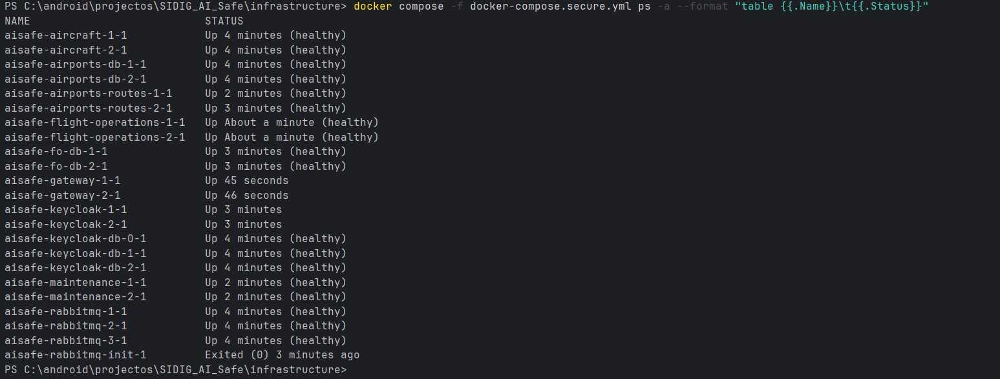

**Cluster RabbitMQ com 3 nós** e **filas *quorum* do FO**:

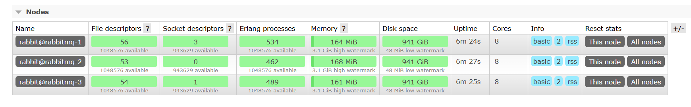

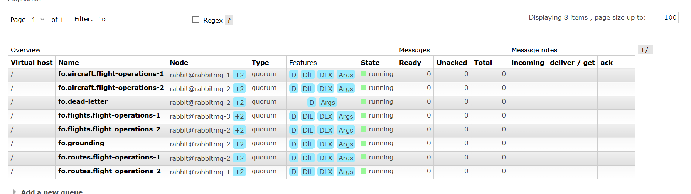

**Agendar numa réplica e ler nas duas** (a gateway alterna entre réplicas; `X-Served-By` mostra qual respondeu):

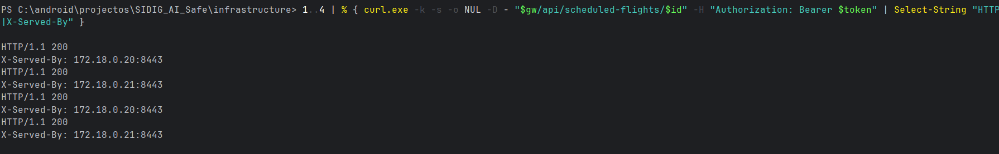

**Broker totalmente em baixo:** o agendamento é aceite (AP); a outra réplica só recebe o voo quando o broker volta:

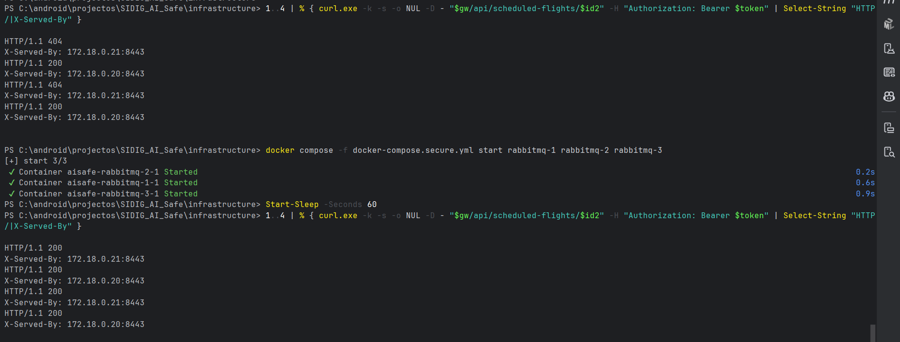

**Failover da BD do Keycloak** (o repmgr promove um standby):

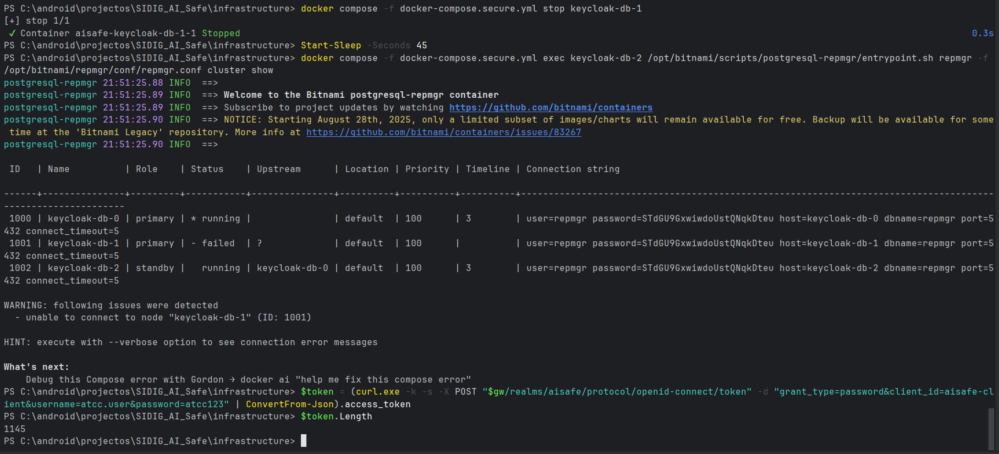

**Réplica com a BD vazia:** o `SnapshotBootstrapper` copia os voos da outra réplica:

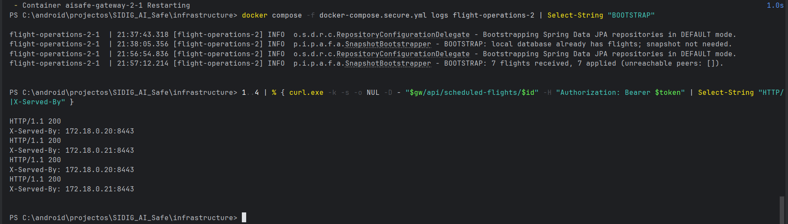

**BD de uma réplica em baixo (07.17):** a réplica 1 responde `503`, a gateway repete o pedido na réplica 2 e todas as
leituras e escritas têm sucesso:

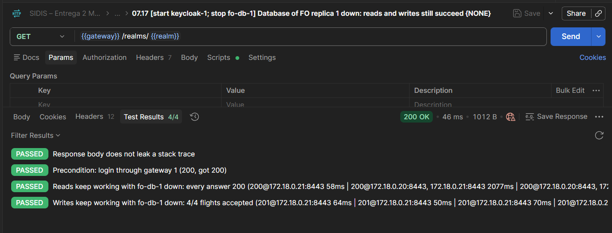

**Recuperação (07.18):** com a BD de volta, o FO-1 fica com todos os voos criados durante a falha, incluindo os cujos
eventos foram para a *dead-letter* (repostos pelo `ReplicaSyncReconciler`):

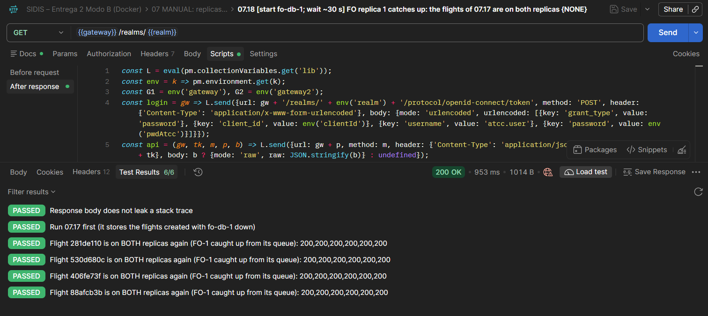

### Modo A (IntelliJ, 3 réplicas)

**Filas do FO no Modo A** (uma por réplica):

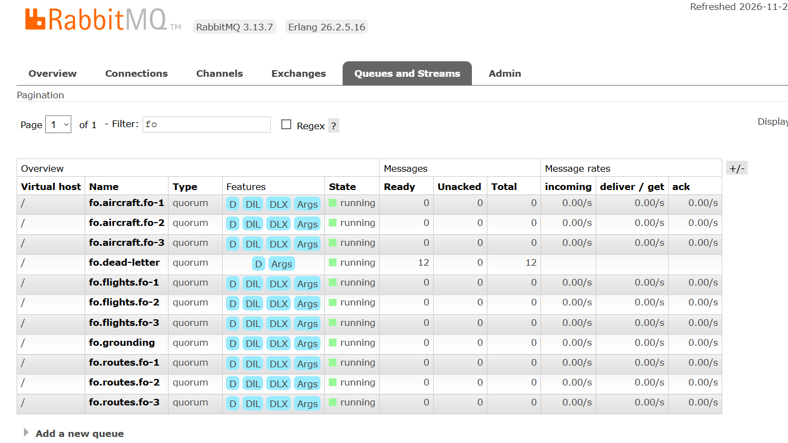

**FO-2 parado (08.01):** o voo é agendado no FO-1; o evento fica na fila `fo.flights.fo-2`:

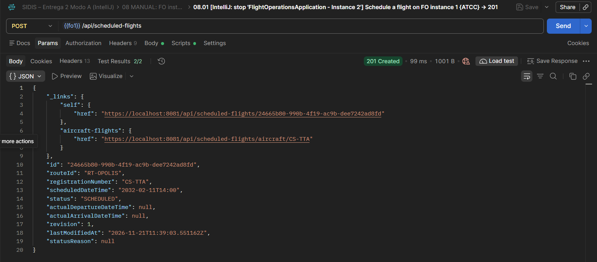

**FO-2 de volta (08.02):** consome a sua fila e fica com o voo:

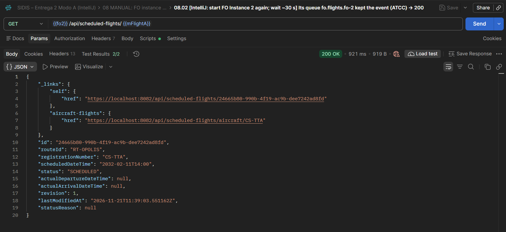

**Testes JUnit:**

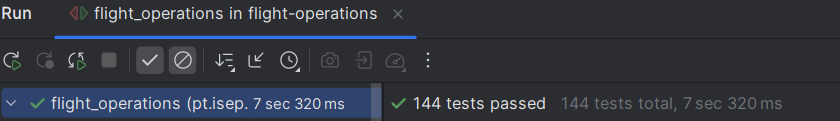

