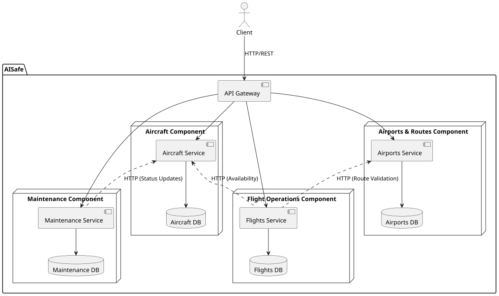
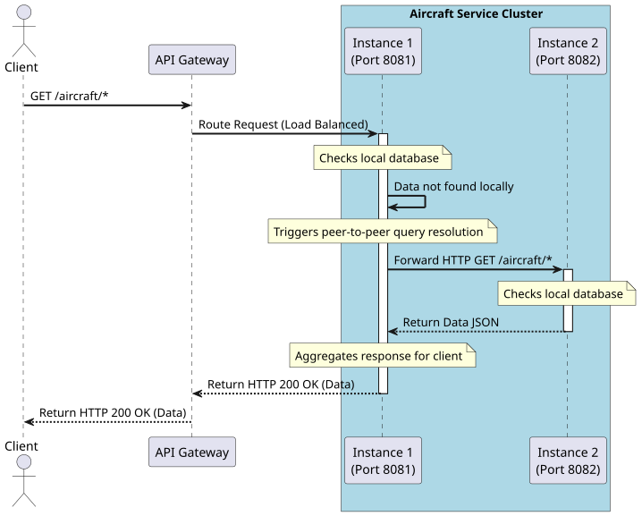

# System Architecture Overview

This project's goal is to progressively transform the AISafe Flight Management System into a distributed microservice architecture. It focuses on maintaining high availability, fault tolerance and establishing clear domain boundaries. 

The system is split into four distinct network services communicating over HTTP/REST protocols. Each service encapsulates a specific business domain, operates independently, and manages its own underlying data store.

In front of the system is an API Gateway system which should act as the entry point into the overall system, allowing clients to interact with it.

 

## Service Segregation & Design Rationale

We have chosen a four-component architecture to strictly enforce loose coupling and better adhere to Domain-Driven Design (DDD) principles.

The services are defined as follows:

| **Service** | **Responsabilities** | **Rationale** |
| ----------- | -------------------- | ------------- |
| Aircraft | Manages aircraft models, specific aircraft instance registration, and tracks operational status. | Decoupling Aircraft from Maintenance prevents a Single Point Of Failure (SPOF) for core asset management and allows independent scaling if aircraft query loads increase. |
| Maintenance | Manages maintenance templates, tracks ongoing maintenance activities, and stores historical maintenance records. | Maintenance is a distinct operational context. Separating it allows specialized data structures for heavy historical logging without impacting the performance of real-time aircraft status queries. |
| Airports & Routes | Registers airports, defines flight routes, and maintains route compatibility rules. | This acts as the geographical and spatial foundation of the system. It is highly read-heavy and benefits from being isolated from transactional operational data. |
| Flight Ops. | Coordinates flight scheduling, assigns specific aircraft to routes based on physical constraints, and tracks real-time flight utilization. | Acts as an orchestrator that consumes data from the other three services to perform complex business logic. |

# Data Decomposition Strategy
To achieve true distribution, the system uses a strict **Database-per-Service** pattern.

- No service is allowed to access another service's database directly. 
- Data is not duplicated, for example: when the Flights Service schedules a flight, it stores the aircraft's ID as a reference, querying the Aircraft Service when detailed information is required.

# Consistency Model & CAP Theorem Alignment
In accordance with distributed systems best practices, this architecture prioritizes **Availability and Partition Tolerance (AP)** over Strong Consistency (CP).

## Eventual Consistency
Because data is distributed across distinct services and replicated across instances, the system embraces eventual consistency. For example: if an aircraft is marked for maintenance, there may be a brief window where the Flights Service still sees it as available until the update fully propagates.

## Conflict Resolution
We will implement mechanisms such as optimistic locking to handle concurrent updates to the same resource across different nodes.

# Fault Tolerance & Resilience Mechanisms

The system is designed to survive the failure of individual nodes and temporary network partitions.

## Instance Replication
 Each of the four services will be deployed with at least two running instances (replicas) mapped to unique ports.

## Peer-to-Peer Data Forwarding
 If a client requests a specific resource from Instance A, and Instance A does not have that data in its local replica database, Instance A will automatically forward the query to its peers (Instances B and C), aggregate the response, and return it to the client.

## Graceful Degradation
If the Maintenance Service goes entirely offline, the Aircraft, Airports, and Flights services will remain operational, allowing the core business of scheduling and querying existing flights to continue unimpeded.

# References
::: {#refs}
:::
