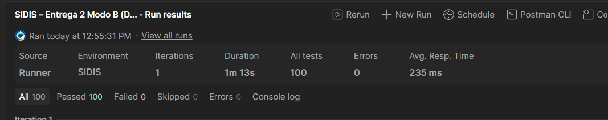
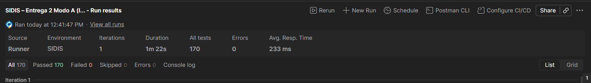

# AISafe – Sistemas Distribuídos (SIDIS)

Documentação geral do grupo para as entregas de SIDIS. Cada serviço tem o seu próprio README com o detalhe;
este documento junta o que é comum: arquitetura, como arrancar, como testar e onde está cada coisa.

| Entrega       | Tema                                                                                   | Diagramas    |
|---------------|----------------------------------------------------------------------------------------|--------------|
| **Entrega 1** | Monólito decomposto em serviços replicados, gateway, Keycloak, replicação P2P          | [`E1/`](E1/) |
| **Entrega 2** | CQRS, AMQP (RabbitMQ), Database-per-Service, 2+ instâncias por serviço, testes Postman | [`E2/`](E2/) |

---

## Entrega 2 – Resumo

| Requisito do enunciado                       | Como foi feito                                                                                                                                                                                                                                 |
|----------------------------------------------|------------------------------------------------------------------------------------------------------------------------------------------------------------------------------------------------------------------------------------------------|
| **CQRS**                                     | Lado dos comandos (agregados JPA) separado do lado das queries (tabelas/vistas de leitura atualizadas por projetores). As queries só leem o modelo de leitura.                                                                                 |
| **AMQP + Message Broker**                    | RabbitMQ. Cada escrita grava o agregado e o evento numa tabela de *outbox* **na mesma transação**; um publicador envia-o para o broker (com *publisher confirms*). Cada instância tem a **sua fila**, por isso todas recebem todos os eventos. |
| **APIs externas em REST**                    | Sem alterações: os clientes continuam a usar HTTPS/REST através da gateway.                                                                                                                                                                    |
| **Database-per-Service**                     | Uma base de dados **por instância** (PostgreSQL no Modo B). Nenhuma instância lê a base de outra; só se sincronizam por eventos.                                                                                                               |
| **≥ 2 instâncias por serviço**               | Modo B: 2 por serviço. Modo A: 3 por serviço.                                                                                                                                                                                                  |
| **Testes Postman**                           | Coleções em [`tests(postman)/`](../../tests(postman)/) (secção "Testes").                                                                                                                                                                      |
| **Sem pontos únicos de falha**               | Modo B: 2 gateways, 2 Keycloak com BD em failover (3 nós repmgr), cluster RabbitMQ de 3 nós, 2 instâncias por serviço; testado com falhas reais ([`infrastructure/README_E2.md`](../../infrastructure/README_E2.md), secções 3 e 5).           |

**Modelo de consistência:** forte dentro de uma instância (o projetor corre na mesma transação do comando, por isso há
*read-your-writes*); **eventual** entre instâncias (normalmente < 2 s). Conflitos resolvidos por *last-writer-wins*.
O sistema é **AP**: aceita escritas com o broker ou outra instância em baixo; o *outbox* guarda os eventos até poderem ser entregues.
No Flight Operations, uma sincronização periódica entre instâncias (*anti-entropy*) repõe qualquer evento que se tenha perdido.

### Estado por serviço

| Serviço | CQRS | AMQP | BD por instância | Documentação |
|---|---|---|---|---|
| Airports & Routes | ✔ | ✔ (exchange fanout `airports.events`) | ✔ PostgreSQL (Modo B) / H2 em ficheiro (Modo A), Flyway | [`README_E2.md`](../../Services/Airport%20e%20Routes/airports-routes-service/README_E2.md) |
| Flight Operations | ✔ | ✔ (exchange topic `flights.events`; consome `airports.events` e `aircraft.events`) | ✔ PostgreSQL (Modos A e B), Flyway | [`README_E2.md`](../../Services/Flighting%20Operations/README_E2.md) |
| Aircraft | ver README do serviço | | | `Services/Aircraft/` |
| Maintenance | ver README do serviço | | | `Services/Maintenance/` |

### Comunicação entre serviços

```
Cliente ──HTTPS/REST──► Gateway (NGINX) ──► instâncias dos serviços
                                               │  escrita: agregado + evento (outbox) numa transação
                                               ▼
                                         RabbitMQ (cluster de 3 nós no Modo B)
             airports.events (fanout) ──► airports.events.<instância>   (outras instâncias do Airports)
                                     └──► fo.routes.<instância>         (Flight Operations: rotas → route_ref)
             flights.events  (topic)  ──► fo.flights.<instância>        (outras instâncias do FO)
                                     └──► fo.grounding                  (pedidos de grounding; uma só instância trata cada um)
             aircraft.events (topic)  ──► fo.aircraft.<instância>       (Flight Operations: aviões → aircraft_ref)
                                     ├──► fo.grounding                  (avião deixa de estar ACTIVE)
                                     └──► maintenance.aircraft.<inst.>  (Maintenance: aviões)
          maintenance.events (fanout) ──► aircraft.maintenance          (Aircraft: início/fim de manutenção; fila partilhada)
```


---

## Como arrancar

Escolher **um** modo. O Modo A e o Modo B **não podem correr ao mesmo tempo** (ambos usam as portas 8443 e 15672).

> **Base de dados do Airports & Routes (Flyway).** O esquema é criado por migrações Flyway
> (`db/migration/V1__airports_routes_schema.sql`) e só numa base **vazia**. Bases criadas antes pelo Hibernate têm de ser
> apagadas **uma vez** (comandos em cada modo, abaixo). Os dados iniciais voltam a ser carregados no arranque.
> No IntelliJ, depois de alterar o `pom.xml`: janela **Maven → Reload All Maven Projects**.

### Trocar de modo

| De → Para       | Comandos (PowerShell, na pasta `infrastructure`)                                                                                                   |
|-----------------|----------------------------------------------------------------------------------------------------------------------------------------------------|
| Modo A → Modo B | Parar os serviços no IntelliJ e fechar a janela do Keycloak; `.\start-infra.ps1 -Stop`; `docker stop aisafe-rabbitmq-1 fo-db-a1 fo-db-a2 fo-db-a3` |
| Modo B → Modo A | `docker compose -f docker-compose.secure.yml stop`                                                                                                 |

### Modo B – Docker 

Tudo em containers: 2 gateways, 2 Keycloak (+ BD com failover), cluster RabbitMQ de 3 nós, 2 instâncias de cada serviço,
cada uma com a sua PostgreSQL.

```powershell
cd infrastructure
.\docker\gen-certs.ps1      # só na primeira vez: certificados + .env com segredos aleatórios
docker compose -f docker-compose.secure.yml up -d --build
docker compose -f docker-compose.secure.yml ps -a   # esperar por "healthy"; rabbitmq-init fica "Exited (0)"
```

**Só uma vez, ao passar para o Flyway** (apaga apenas as bases do Airports & Routes; FO e Keycloak ficam intactos):
```powershell
docker compose -f docker-compose.secure.yml down
docker volume rm aisafe_airports-db-1-data aisafe_airports-db-2-data
docker compose -f docker-compose.secure.yml up -d --build
docker compose -f docker-compose.secure.yml logs airports-routes-1 | Select-String "migration"   # "Successfully applied 1 migration"
```

| O quê            | Onde                                                       |
|------------------|------------------------------------------------------------|
| Gateways         | `https://localhost:8443` e `https://localhost:8444`        |
| Consola RabbitMQ | `http://localhost:15672` (utilizador e password no `.env`) |

Parar: `docker compose -f docker-compose.secure.yml stop`.

### Modo A – IntelliJ

Os serviços correm no IntelliJ (3 instâncias cada). Na Entrega 2 o Docker é usado **só** para o RabbitMQ e para as
bases PostgreSQL do Flight Operations.

**1. Infraestrutura em Docker (RabbitMQ + 3 PostgreSQL do FO)**
```powershell
cd infrastructure
docker compose -f docker-compose.services.yml up -d rabbitmq
docker run -d --name fo-db-a1 -p 5441:5432 -e POSTGRES_DB=flightops -e POSTGRES_USER=flightops -e POSTGRES_PASSWORD=flightops postgres:16-alpine
docker run -d --name fo-db-a2 -p 5442:5432 -e POSTGRES_DB=flightops -e POSTGRES_USER=flightops -e POSTGRES_PASSWORD=flightops postgres:16-alpine
docker run -d --name fo-db-a3 -p 5443:5432 -e POSTGRES_DB=flightops -e POSTGRES_USER=flightops -e POSTGRES_PASSWORD=flightops postgres:16-alpine
```
Nas vezes seguintes: `docker compose -f docker-compose.services.yml start rabbitmq` e `docker start fo-db-a1 fo-db-a2 fo-db-a3`.
Consola RabbitMQ: `http://localhost:15672` (`aisafe` / `aisafe-mq`). O aviso *orphan containers* pode ser ignorado
(são os containers parados do Modo B); **não** usar `--remove-orphans`.

**2. Keycloak + gateway**
```powershell
.\start-infra.ps1           # Keycloak em http://localhost:8180, gateway em https://localhost:8443
```

**3. Truststore** (uma vez). Todas as Run Configurations usam `-Djavax.net.ssl.trustStore=<caminho>\truststore.p12`.
Se o ficheiro não existir, criar a partir do `keystore.p12` comum aos serviços:
```powershell
keytool -exportcert -alias aisafe-key -keystore keystore.p12 -storetype PKCS12 -storepass password -file aisafe.crt
keytool -importcert -alias aisafe -file aisafe.crt -keystore truststore.p12 -storetype PKCS12 -storepass password -noprompt
```

**4. Variáveis de ambiente novas da Entrega 2** (nas Run Configurations)

| Run Configuration                                | Variáveis                                                               |
|--------------------------------------------------|-------------------------------------------------------------------------|
| Airports - Instância 1, 2, 3                     | `SPRING_RABBITMQ_USERNAME=aisafe`, `SPRING_RABBITMQ_PASSWORD=aisafe-mq` |
| FlightOperationsApplication - Instance 1 / 2 / 3 | `DB_URL=jdbc:postgresql://localhost:5441/flightops` / `5442` / `5443`   |

**5. Só uma vez, ao passar para o Flyway:** com as instâncias do Airports paradas, apagar as bases H2 antigas
(na raiz do repositório):
```powershell
Remove-Item data\airports_db_*.mv.db, data\airports_db_*.trace.db -ErrorAction SilentlyContinue
```

**6. Arrancar os serviços** (por esta ordem): Aircraft 1-3 → Maintenance 1-3 → Airports 1-3 → Flight Operations 1-3.
Na consola de cada instância do Airports aparece `Successfully applied 1 migration` (só na primeira vez) e
`Modelo de leitura reconstruido: N aeroportos, M rotas`.

| Serviço           | Portas           |
|-------------------|------------------|
| Flight Operations | 8081, 8082, 8083 |
| Aircraft          | 8071, 8072, 8073 |
| Maintenance       | 8075, 8076, 8077 |
| Airports & Routes | 8091, 8092, 8093 |

Parar: `.\start-infra.ps1 -Stop` (Keycloak: Ctrl+C na janela dele), `docker compose -f docker-compose.services.yml stop rabbitmq`,
`docker stop fo-db-a1 fo-db-a2 fo-db-a3`.

---

## Testes

| Coleção                                                                                                                     | Modo  | Conteúdo                                                                                                                                                                                                                |
|-----------------------------------------------------------------------------------------------------------------------------|-------|-------------------------------------------------------------------------------------------------------------------------------------------------------------------------------------------------------------------------|
| `SIDIS – Entrega 2 Modo B (Docker).postman_collection.json` / `SIDIS – Entrega 2 Modo A (IntelliJ).postman_collection.json` | B / A | Coleções completas da Entrega 2 (todos os serviços). Modo B: 111 testes automáticos (pastas 00–06) e 18 manuais de falhas (pasta 07). Modo A: 181 testes automáticos (00–07) e 3 pastas manuais (08–10). Todos a passar |
| `SIDIS – Modo A (IntelliJ)` / `SIDIS – Modo B (Docker)`                                                                     | A / B | Coleções da Entrega 1                                                                                                                                                                                                   |
Como correr:
1. Importar a coleção e o environment `SIDIS.postman_environment.json`; selecionar o environment **SIDIS**.
2. Desligar *SSL certificate verification* nas definições do Postman.
3. No environment, acrescentar `rabbitUser`, `rabbitPassword` e `rabbitMgmt` (`http://localhost:15672`), usados pelos
   testes que publicam diretamente no RabbitMQ: no Modo B os valores de `RABBITMQ_USER` / `RABBITMQ_PASSWORD` do `.env`;
   no Modo A `aisafe` / `aisafe-mq`. Não guardar a password do `.env` no ficheiro do environment que vai para o Git.
4. *Collection Runner*, 100 ms de atraso, **sem** as pastas MANUAL. As pastas MANUAL correm-se pedido a pedido,
   executando antes a ação indicada entre `[ ]` (parar/arrancar uma instância).

Resultado do Modo B (pastas 00–06, Collection Runner):



Resultado do Modo A (pastas 00–07, 3 instâncias de cada serviço):



Os testes de convergência escrevem numa instância e leem noutra até os dados aparecerem. Nas leituras do Airports
é enviado `X-P2P-Hops: 1`, que desliga o reencaminhamento entre instâncias: um 200 prova que o evento chegou pelo RabbitMQ.

### JUnit

No IntelliJ, depois de alterar o `pom.xml`: **Maven → Reload All Maven Projects**.

Em cada serviço: `.\mvnw.cmd test` (não precisa de Docker; usa H2 e mocks).

---

## Estrutura da documentação

| Pasta                                                                                                                          | Conteúdo                                                                                                              |
|--------------------------------------------------------------------------------------------------------------------------------|-----------------------------------------------------------------------------------------------------------------------|
| [`E1/`](E1/)                                                                                                                   | Diagramas da Entrega 1 (C4, vista física, replicação P2P, autenticação, alta disponibilidade)                         |
| [`E2/`](E2/)                                                                                                                   | Diagramas da Entrega 2 (C4, topologia de mensagens, vista física Docker, replicação por eventos, tolerância a falhas) |
| [`screenshots/`](screenshots/)                                                                                                 | Evidências da execução                                                                                                |
| `Services/*/docs/`                                                                                                             | Diagramas e evidências de cada serviço                                                                                |
| [`../../infrastructure/README.md`](../../infrastructure/README.md)                                                             | Detalhe da infraestrutura (Keycloak, gateway, certificados)                                                           |
| [`../../infrastructure/README_E2.md`](../../infrastructure/README_E2.md)                                                       | Infraestrutura da Entrega 2: RabbitMQ, BD do Keycloak com failover, sem SPOFs, testes manuais de falhas, Modo A       |
| [`Group_Composition.md`](Group_Composition.md), [`Non-Technical.md`](Non-Technical.md), [`autoavaliação.md`](autoavaliação.md) | Grupo e avaliação                                                                                                     |
