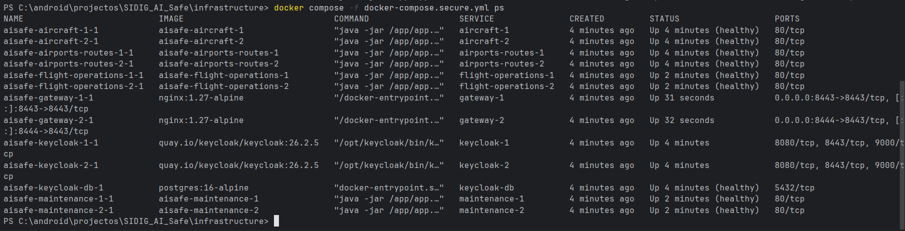
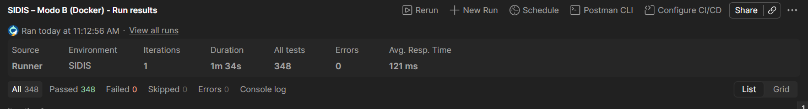
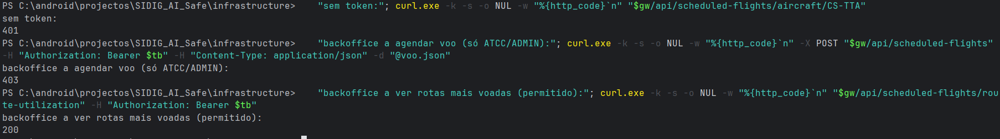
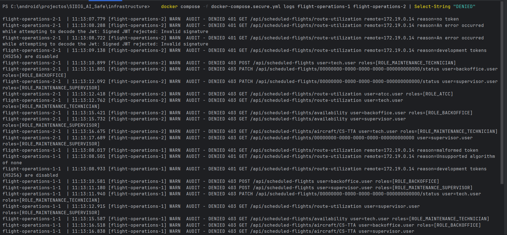
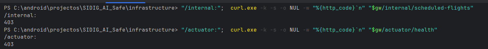
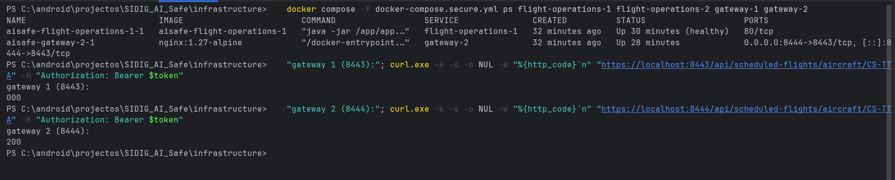
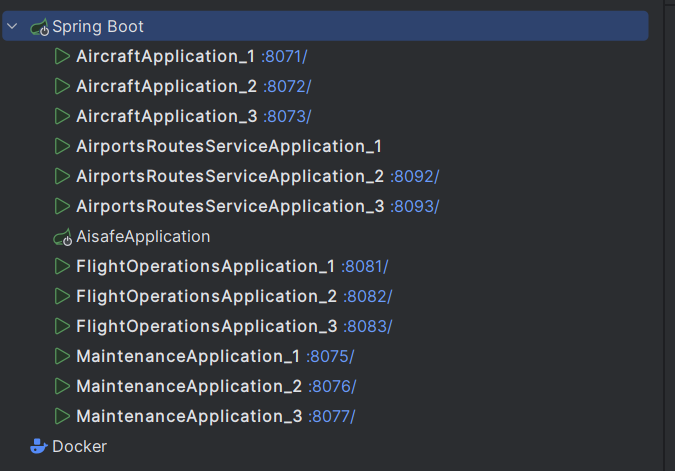
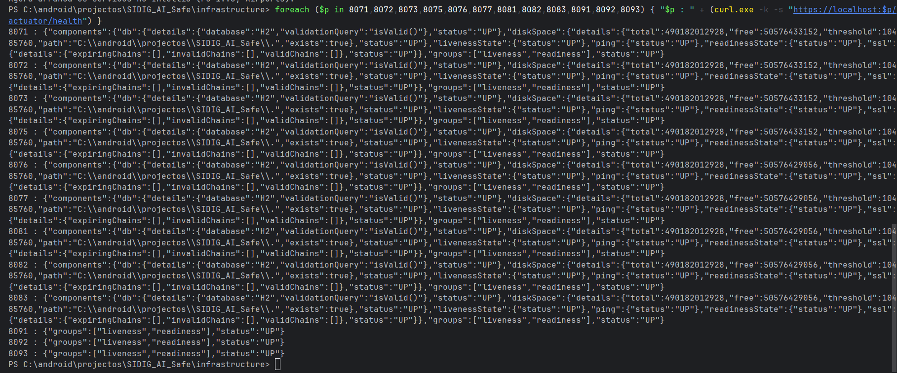
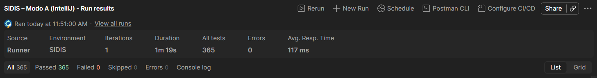

# AISafe – Infraestrutura (Keycloak + API Gateway)

Esta pasta contém tudo o que é preciso para correr o sistema distribuído: 4 serviços replicados
(Aircraft, Maintenance, Airports & Routes, Flight Operations), o Keycloak e a API Gateway.

Há **três formas de arrancar**. Escolher uma; **não correr o Modo A e o Modo B ao mesmo tempo**
(ambos usam a porta 8443).

|                      | **Modo A – IntelliJ**                                             | **Modo B – Docker seguro**                                                                  | **Modo C – só serviços**                                   |
|----------------------|-------------------------------------------------------------------|---------------------------------------------------------------------------------------------|------------------------------------------------------------|
| Para quê             | Desenvolver, depurar e testar com acesso direto às réplicas       | Demonstração e testes de resiliência, mais próximo de produção                              | Teste rápido dos serviços, sem gateway nem Keycloak        |
| Arranque             | `start-infra.ps1` + serviços no IntelliJ                          | `docker compose -f docker-compose.secure.yml up --build`                                    | `docker compose -f docker-compose.services.yml up --build` |
| Gateway              | 1 NGINX (`:8443`)                                                 | 2 NGINX (`:8443` e `:8444`)                                                                 | nenhuma                                                    |
| Keycloak             | 1 instância (`:8180`)                                             | 2 instâncias + Postgres                                                                     | nenhum                                                     |
| Autenticação         | JWT RS256 do Keycloak (tokens HS256 de teste aceites por omissão) | JWT RS256 do Keycloak (tokens HS256 de teste desligados, exceto entre réplicas do Airports) | tokens HS256 de teste (valor por omissão)                  |
| Réplicas por serviço | 3 (Airports: perfis `inst1` a `inst3`)                            | 2                                                                                           | 2                                                          |
| Transporte           | HTTPS                                                             | HTTPS em todos os saltos                                                                    | HTTP                                                       |
| Portas publicadas    | gateway e cada réplica                                            | só as gateways                                                                              | cada réplica                                               |

```
Cliente (Postman/curl)
   │  HTTPS :8443  (Modo B: também :8444)
   ▼
API Gateway (NGINX) ──► /realms/...                    Keycloak (login, emite JWT RS256)
   │                ──► /api/scheduled-flights         Flight Operations (round-robin entre réplicas)
   │                ──► /api/airports, /api/routes     Airports & Routes
   │                ──► /api/aircraft-models, /api/aircraft   Aircraft
   │                ──► /api/maintenance               Maintenance
   │                ✖   /internal/, /actuator/, /h2-console/  (bloqueados)
   ▼
Cada serviço valida o JWT com a chave pública do Keycloak (JWKS) e aplica RBAC.
```

| Pasta / ficheiro              | Conteúdo                                                                                                                            |
|-------------------------------|-------------------------------------------------------------------------------------------------------------------------------------|
| `keycloak/aisafe-realm.json`  | Realm `aisafe`: 5 perfis, 5 utilizadores de teste, cliente `aisafe-client`                                                          |
| `gateway/nginx.conf`          | Gateway do Modo A: HTTPS, routing, round-robin, failover, rate limiting (10 req/s por IP, burst 20), bloqueio de endpoints internos |
| `start-infra.ps1`             | Modo A: copia as configurações, gera os certificados PEM e arranca Keycloak + NGINX                                                 |
| `docker-compose.secure.yml`   | Modo B: stack completa em containers                                                                                                |
| `docker/`                     | Modo B: `gen-certs.ps1` (certificados e `.env`) e `nginx.docker.conf`                                                               |
| `docker-compose.services.yml` | Modo C: só os serviços                                                                                                              |

---

## Resumo das decisões de desenho

| Tema                | Decisão                                                                                                                                                                        |
|---------------------|--------------------------------------------------------------------------------------------------------------------------------------------------------------------------------|
| Decomposição        | 4 serviços independentes, cada um com a sua BD: Aircraft, Maintenance, Airports & Routes, Flight Operations                                                                    |
| Replicação          | 2 ou 3 réplicas por serviço; o gateway faz round-robin e passa à réplica seguinte se uma falhar                                                                                |
| Consistência        | Eventual, privilegiando disponibilidade e tolerância a partições (AP do teorema CAP). As escritas são aceites localmente e replicadas de forma assíncrona para os pares.       |
| Leituras P2P        | Uma réplica que não tem o dado pergunta aos pares (cabeçalho `X-P2P-Hops` contra ciclos), agrega as respostas e devolve uma resposta coerente. Sinaliza os pares inacessíveis. |
| Tolerância a falhas | Circuit breaker nas chamadas entre serviços, degradação controlada (por exemplo `available=false` se o Aircraft estiver em baixo) e fila de replicação com reenvio             |
| Autenticação        | JWT RS256 do Keycloak validado em cada serviço; API key nas rotas `/internal/**`; token HS256 entre réplicas do Airports                                                       |
| Autorização         | RBAC com 5 perfis (ADMIN, ATCC, BACKOFFICE, MAINTENANCE_TECHNICIAN, MAINTENANCE_SUPERVISOR)                                                                                    |
| Cifra em trânsito   | HTTPS cliente→gateway→serviço→serviço (Modos A e B)                                                                                                                            |
| Exposição           | O gateway bloqueia `/internal/`, `/actuator/` e `/h2-console/` e limita a 10 pedidos/s por IP                                                                                  |
| Auditoria           | Logger `AUDIT` em todos os serviços (ver a secção "Auditoria")                                                                                                                 |

---

## Modo A – IntelliJ + Keycloak e NGINX locais

### Instalação (uma vez)
1. **Keycloak**: descarregar o zip em keycloak.org/downloads e descomprimir em `C:\keycloak` (precisa de Java 21+).
2. **NGINX**: descarregar *nginx/Windows* (Stable) em nginx.org/en/download.html e descomprimir em `C:\nginx`.
3. **Git for Windows** (traz o `openssl`, usado para converter o `keystore.p12` em PEM).
4. **Truststore** dos serviços: criar com os comandos `keytool` da secção 4.1 do README do Flight Operations
   (`Services/Flighting Operations/README.md`). Todos os serviços arrancam com as mesmas VM options:
   ```
   -Djavax.net.ssl.trustStore="<pasta>\certs\truststore.p12" -Djavax.net.ssl.trustStorePassword=password -Djavax.net.ssl.trustStoreType=PKCS12
   ```

### Arrancar
```powershell
cd <repo>\infrastructure
$env:JAVA_HOME = "<caminho do JDK 21+>"
.\start-infra.ps1          # Keycloak + gateway
```
Depois arrancar os serviços no IntelliJ (uma Run Configuration por réplica). Antes de testar, tem de estar isto a correr:

| # | O quê                  | Onde arrancar                              | Porta            |
|---|------------------------|--------------------------------------------|------------------|
| 1 | Keycloak               | `start-infra.ps1` (janela própria)         | 8180 (HTTP)      |
| 2 | API Gateway (NGINX)    | `start-infra.ps1`                          | 8443 (HTTPS)     |
| 3 | Airports & Routes (×3) | IntelliJ, perfis `inst1`, `inst2`, `inst3` | 8091, 8092, 8093 |
| 4 | Aircraft (×3)          | IntelliJ                                   | 8071, 8072, 8073 |
| 5 | Maintenance (×3)       | IntelliJ                                   | 8075, 8076, 8077 |
| 6 | Flight Operations (×3) | IntelliJ                                   | 8081, 8082, 8083 |

Variáveis de ambiente por réplica (exemplo para a 1.ª de cada serviço; nas restantes mudar `PORT`, `INSTANCE_ID` e `PEERS`):

| Serviço           | Variáveis                                                                                                                                                               |
|-------------------|-------------------------------------------------------------------------------------------------------------------------------------------------------------------------|
| Airports & Routes | Active profiles `inst1` (ou `inst2`, `inst3`); `KEYSTORE_PASSWORD=password;JWT_SECRET=change-this-development-secret-key-with-at-least-32-bytes`                        |
| Aircraft          | `PORT=8071;INSTANCE_ID=aircraft-1;PEERS=https://localhost:8072,https://localhost:8073;ROUTES_URLS=https://localhost:8091,https://localhost:8092,https://localhost:8093` |
| Maintenance       | `PORT=8075;INSTANCE_ID=maintenance-1;PEERS=https://localhost:8076,https://localhost:8077`                                                                               |
| Flight Operations | `PORT=8081;INSTANCE_ID=fo-1;PEERS=https://localhost:8082,https://localhost:8083` (restantes opções: ver o README do serviço)                                            |

Verificar cada réplica: `curl.exe -k https://localhost:8081/actuator/health` (deve devolver `UP`).

Erros típicos:
- `503 "No replica of the requested service is available."` → a gateway não chega a nenhuma réplica desse serviço (estão paradas).
- `503 "Service airports-routes/aircraft unavailable"` → o FO respondeu, mas a dependência está parada; depois de a arrancar, esperar ~10 s (circuit breaker).

Parar a gateway: `.\start-infra.ps1 -Stop` (o Keycloak para com Ctrl+C na janela dele).

**Limitações do Modo A:** a gateway e o Keycloak são instâncias únicas (pontos únicos de falha, aceites para desenvolvimento); as BDs H2 são em memória, exceto no Airports & Routes, que no Modo A guarda-as em ficheiros (`data/airports_db_N`).

---

## Modo B – Docker seguro

Stack completa em containers: Keycloak, gateways NGINX e 4 serviços × 2 réplicas, com HTTPS em todos os saltos.
Só é preciso o Docker Desktop. **Parar antes o Modo A** (incluindo o NGINX local).

```powershell
cd infrastructure\docker
.\gen-certs.ps1                                   # uma vez: cria .env (segredos aleatórios) e certificados
cd ..
docker compose -f docker-compose.secure.yml up --build
docker compose -f docker-compose.secure.yml ps    # esperar que tudo fique "healthy"
```

> **Antes de arrancar, confirmar que o Modo A está parado.** Se o NGINX ou o Keycloak locais continuarem a correr, ocupam as
> portas `8443` e `8180`, e o Postman fala com eles em vez de falar com o Docker (erros `403`, `404`, `500` e `503` sem
> sentido). Verificar que o resultado deste comando é **vazio**:
> ```powershell
> Get-NetTCPConnection -LocalPort 8443,8444,8180,8071,8072,8073,8075,8076,8077,8081,8082,8083,8091,8092,8093 -State Listen -ErrorAction SilentlyContinue |
>   Select-Object LocalPort, OwningProcess, @{n='Processo';e={(Get-Process -Id $_.OwningProcess).ProcessName}}
> ```
> Para parar o que sobrar: `.\start-infra.ps1 -Stop` (NGINX), `Stop-Process -Id <PID>` (Keycloak e serviços) e parar as
> Run Configurations do IntelliJ. Depois de arrancar o Docker, esperar que tudo fique `healthy` e mais 1 a 2 minutos antes
> de correr o Postman.

Resultado esperado: os 13 containers `Up` (os que têm *healthcheck* ficam `healthy`).



Entrada: `https://localhost:8443` (gateway-1) ou `https://localhost:8444` (gateway-2).
Login em `/realms/aisafe/protocol/openid-connect/token`. Parar: `docker compose -f docker-compose.secure.yml down`.

Containers: `keycloak-db`, `keycloak-1`, `keycloak-2`, `aircraft-1`/`-2`, `maintenance-1`/`-2`,
`airports-routes-1`/`-2`, `flight-operations-1`/`-2`, `gateway-1` (8443) e `gateway-2` (8444).

Simular falhas: `docker compose -f docker-compose.secure.yml stop flight-operations-2` (e `start` para recuperar).

> **Atenção ao reconstruir ou recriar serviços.** O NGINX resolve os nomes dos serviços (`aircraft-1`, `maintenance-2` …)
> **só quando arranca** e guarda os IPs. Se um serviço for recriado (por exemplo com `up --build`), o Docker pode dar o seu
> IP antigo a outro container, e o gateway passa a enviar pedidos para o serviço errado (sintoma: `403` ou `404` em
> `/api/aircraft` ou `/api/maintenance`, ou só uma réplica a responder). Depois de reconstruir ou recriar qualquer serviço,
> **reiniciar os gateways**:
> ```powershell
> docker compose -f docker-compose.secure.yml restart gateway-1 gateway-2
> ```
> A forma mais segura de atualizar tudo é `docker compose -f docker-compose.secure.yml down` seguido de `up --build -d`.

Medidas de segurança deste modo:
- HTTPS cliente→gateway, gateway→serviço (certificado verificado) e serviço→serviço (certificado com SAN dos containers).
- Tokens do Keycloak (RS256) validados em cada serviço; tokens de teste (HS256) desligados em FO, Aircraft e Maintenance.
  Na Airports ficam ligados porque as réplicas se autenticam entre si com um token HS256 assinado com o `JWT_SECRET`
  (aleatório, no `.env`, fora do Git).
- Só as gateways publicam porta; os serviços e o Keycloak estão numa rede interna sem acesso à internet.
- Segredos (`API_KEY`, `JWT_SECRET`, palavra-passe do keystore e do admin do Keycloak) no `.env`, gerados aleatoriamente.
- Containers com `no-new-privileges` e sem capacidades Linux extra.

**Alta disponibilidade e limitações:**
- Gateways: 2 instâncias, sem balanceador à frente (o cliente usa `:8443` ou `:8444`).
- Keycloak: 2 instâncias a partilhar um único Postgres (`keycloak-db`), que é o ponto único de falha que resta.
  Se parar, os tokens já emitidos continuam válidos até expirarem, mas novos logins falham.
- Cada serviço tolera a falha de uma réplica (round-robin com `proxy_next_upstream`).
- Certificado autoassinado e sem mTLS entre serviços (a autenticação entre serviços usa API key e JWT).
- BD H2 em memória e listas de peers estáticas; a fila de replicação pendente fica em memória.
- Consistência eventual (AP): uma escrita só chega às outras réplicas passado algum tempo (até ~5 s no Airports, que replica
  de 5 em 5 s). Um pedido que caia noutra réplica nesse intervalo pode ainda não ver o dado (por exemplo, uma rota acabada de
  criar ou desativada). Os testes automáticos esperam por essa convergência.
- Maintenance: tanto os registos como os *templates* de manutenção são replicados (pela chave global `globalId`, com revisão,
  reenvio de 5 em 5 s e sincronização no arranque). Os identificadores numéricos (`pk`) são locais a cada réplica, por isso os
  clientes devem usar `globalId` / `templateGlobalId` (o `templateId` numérico só serve na réplica que criou o template).
  A fila de reenvio e as BDs H2 ficam em memória: se a réplica que recebeu a escrita cair antes de a entregar a algum par,
  essa escrita perde-se.

---

## Modo C – só serviços (sem gateway nem Keycloak)

`docker-compose.services.yml` arranca duas réplicas de cada serviço, em HTTP, sem gateway nem Keycloak.
Serve para testes rápidos.

```bash
docker compose -f infrastructure/docker-compose.services.yml up --build
```

Cada container escuta na porta `80` internamente. Os serviços chamam-se pelo nome, sem porta
(por exemplo `http://aircraft-1` e `http://aircraft-2`). As portas do host servem só para testes diretos:

| Serviço           |        Réplica 1 |        Réplica 2 |
|-------------------|-----------------:|-----------------:|
| Aircraft          | `localhost:8071` | `localhost:8072` |
| Maintenance       | `localhost:8075` | `localhost:8076` |
| Flight Operations | `localhost:8081` | `localhost:8082` |
| Airports & Routes | `localhost:8091` | `localhost:8092` |

```bash
docker compose -f infrastructure/docker-compose.services.yml ps
curl http://localhost:8071/actuator/health   # e as restantes portas da tabela
docker compose -f infrastructure/docker-compose.services.yml down
```

---

## Testes automáticos (Postman)

Pasta `tests(postman)/` da raiz do repositório:

| Ficheiro | Para |
|---|---|
| `SIDIS.postman_environment.json` | Environment `SIDIS` (URLs, utilizadores de teste, API key) |
| `SIDIS – Modo A (IntelliJ).postman_collection.json` | Entrega 1, Modo A (acesso direto às réplicas) |
| `SIDIS – Modo B (Docker).postman_collection.json` | Entrega 1, Modo B (só via gateway, 2 réplicas, testes de SPOF) |
| `SIDIS – Entrega 2 Modo A (IntelliJ).postman_collection.json` | Entrega 2, Modo A (CQRS, AMQP, base por instância; 188 testes) |
| `SIDIS – Entrega 2 Modo B (Docker).postman_collection.json` | Entrega 2, Modo B (125 testes; ver `docs/SIDIS/README.md`) |

1. Importar o environment e a coleção do modo em uso; escolher o environment `SIDIS`.
2. Em *Settings*, desligar **SSL certificate verification** (certificado autoassinado).
3. *Run collection* nas pastas `00` a `07` (por ordem) com **Delay 100 ms** (a gateway limita a 10 pedidos/s por IP).
   Os tokens, os identificadores de teste (`runId`) e as datas são gerados automaticamente em cada execução, por isso a coleção
   pode repetir-se sem limpar as bases de dados. Alguns pedidos esperam ~6 s pela replicação do Airports (consistência eventual).
4. A pasta `09` é manual: fazer a ação indicada entre `[ ]` no nome do pedido (parar ou arrancar um serviço) e enviar o pedido,
   um a um e não no *Runner*. No Modo A, os pedidos `09.09` a `09.15` são opcionais (exigem reiniciar o FO com variáveis de
   ambiente específicas). No Modo B, a pasta `09` usa só `docker compose stop/start` (ver "Testes manuais de tolerância a falhas").

Notas por modo:
- **Maintenance (ambos os modos):** os pedidos `07.07`, `07.08` e `07.10` passam pelo gateway e referenciam o template e o
  registo pelo `globalId` (variáveis `templateGlobalId` e `recordGlobalId`). No Modo A, o `07.07` verifica ainda, diretamente
  nas três réplicas (`/internal/maintenance/templates`), que o template foi replicado.
- **Modo B:** só as gateways estão publicadas; os testes correm todos através delas.
- Antes de correr, confirmar que **todas** as instâncias estão `UP` (pasta `00b` no Modo A; `docker compose ... ps` no Modo B).

Resultado esperado nas pastas `00` a `07`, sem falhas: **Modo A: 365 testes; Modo B: 348 testes**.



Com Newman: `newman run "tests(postman)/SIDIS – Modo A (IntelliJ).postman_collection.json" -e "tests(postman)/SIDIS.postman_environment.json" --insecure --delay-request 100`

## Testes manuais de tolerância a falhas (Modo B, pasta 09)

Correr cada pedido **um a um** (botão *Send*, não o *Runner*), por ordem, depois de executar o comando indicado.
Cada `stop`/`start` escreve-se como `docker compose -f docker-compose.secure.yml stop <serviço>`.

| Pedido | Antes de enviar                                                                         | Resultado esperado                                                                                                                                                                                                                                                           |
|--------|-----------------------------------------------------------------------------------------|------------------------------------------------------------------------------------------------------------------------------------------------------------------------------------------------------------------------------------------------------------------------------|
| 09.01  | `stop flight-operations-2`                                                              | `201` (AP: a escrita é aceite com uma réplica em baixo)                                                                                                                                                                                                                      |
| 09.02  | (mantém-se parada)                                                                      | `200`/`204` (as leituras continuam disponíveis)                                                                                                                                                                                                                              |
| 09.03  | `start flight-operations-2` e esperar ~30 s (`ps` → healthy)                            | o voo existe nas duas réplicas                                                                                                                                                                                                                                               |
| 09.04  | `stop airports-routes-1 airports-routes-2`                                              | `503` (sem rotas não se agenda)                                                                                                                                                                                                                                              |
| 09.05  | `start airports-routes-1 airports-routes-2` e `stop aircraft-1 aircraft-2`              | `503`                                                                                                                                                                                                                                                                        |
| 09.06  | (aircraft parados)                                                                      | `200` com `available=false` (degradação controlada)                                                                                                                                                                                                                          |
| 09.07  | `start aircraft-1 aircraft-2` e `stop flight-operations-1 flight-operations-2`          | `502`/`503`/`504` no gateway                                                                                                                                                                                                                                                 |
| 09.08  | `start` de tudo e `stop flight-operations-1 airports-routes-1 aircraft-1 maintenance-1` | o sistema continua a responder com uma réplica de cada serviço                                                                                                                                                                                                               |
| 09.09  | `start` de tudo e `stop gateway-1`                                                      | o gateway 2 (`:8444`) continua a servir                                                                                                                                                                                                                                      |
| 09.10  | `start gateway-1` e `stop keycloak-1`                                                   | um novo login continua a funcionar (Keycloak 2); o pedido faz também 3 séries de 16 leituras para pôr a cache de chaves (JWKS) a quente nas réplicas do FO e do Aircraft                                                                                                     |
| 09.11  | `stop keycloak-1 keycloak-2` (logo a seguir ao 09.10)                                   | `200`/`204`: um token emitido antes da falha continua válido, desde que a réplica já tenha as chaves em cache (enviar poucos minutos depois do 09.10, porque a cache expira); uma réplica reiniciada depois (cache vazia) devolve `401` enquanto o Keycloak estiver em baixo |
| 09.12  | (Keycloak parado)                                                                       | `502`/`503`/`504`: um novo login falha; o Keycloak é dependência crítica da autenticação                                                                                                                                                                                     |
| 09.13  | `start` de tudo e esperar healthy                                                       | recuperação total: login, agendar e ler                                                                                                                                                                                                                                      |

Se algum serviço for *recriado* (e não só parado e arrancado), reiniciar também os gateways (ver a nota no Modo B).
SPOF residual: a base de dados do Keycloak (`keycloak-db`) é uma instância única.

## Auditoria (registo de acessos e alterações)

O enunciado pede *controlo de acesso e registo de auditoria*. Cada serviço escreve nos seus logs, com o logger `AUDIT`,
**quem fez o quê**:

| O que se regista                                                                | Exemplo                                           | Onde                                      |
|---------------------------------------------------------------------------------|---------------------------------------------------|-------------------------------------------|
| Escritas de negócio, com o utilizador do token, a ação e o identificador        | `User: atcc.user - Action: CREATE - Target ID: …` | todos os serviços                         |
| Pedidos recusados (sem token, token inválido ou perfil sem permissão)           | `DENIED POST /api/routes`                         | todos os serviços                         |
| Acessos às rotas internas `/internal/**` com a API key (permitidos e recusados) | `ALLOWED …` / `DENIED … from=… remote=…`          | Aircraft, Maintenance e Flight Operations |

Para mostrar na defesa, correr uma pasta do Postman e ver os logs:
```powershell
# Modo B
docker compose -f docker-compose.secure.yml logs aircraft-1 maintenance-1 flight-operations-1 airports-routes-1 | Select-String "AUDIT|DENIED|ALLOWED"
# Modo A: consola de cada serviço no IntelliJ (filtrar por AUDIT / DENIED)
```
Um bom exemplo: o pedido `03.01` (matriz de RBAC) deixa muitos `DENIED` nos logs, e o `04.01` deixa o `CREATE` do utilizador `atcc.user`.
Limitação: o registo é feito em ficheiro/consola de cada instância, sem recolha centralizada.

## Demonstração (capturas do sistema em execução)

As capturas de arranque e de testes do Modo B estão nas secções "Modo B – Docker seguro" e "Testes automáticos (Postman)".

### Modo B – segurança

Autenticação e RBAC: sem token devolve `401`; o utilizador `backoffice.user` não pode agendar voos (só ATCC e ADMIN) e recebe
`403`, mas pode consultar as rotas mais voadas (`200`).



Auditoria: os pedidos recusados ficam registados em cada serviço com o logger `AUDIT` (`DENIED 401` para tokens em falta,
inválidos, forjados, `alg: none` ou de desenvolvimento; `DENIED 403` com o utilizador e os perfis).



A gateway bloqueia `/internal/**` e `/actuator/**` (`403`).



### Modo B – tolerância a falhas

Com uma réplica do Flight Operations e a gateway 1 paradas, a gateway 1 deixa de responder (`000`), mas a gateway 2
(`:8444`) continua a servir (`200`).



### Modo A (IntelliJ)

As 12 Run Configurations (3 réplicas de cada serviço), cada uma na sua porta.



`/actuator/health` das 12 réplicas, todas `UP`.



Collection Runner da coleção do Modo A (pastas `00` a `07`): 365 testes, 0 falhas.



---

## Resolução de problemas

| Sintoma                                                                                                         | Causa provável                                                                                              | O que fazer                                                                                                                  |
|-----------------------------------------------------------------------------------------------------------------|-------------------------------------------------------------------------------------------------------------|------------------------------------------------------------------------------------------------------------------------------|
| `403`/`404` em `/api/aircraft` ou `/api/maintenance` no Modo B; só uma réplica responde                         | O NGINX guardou IPs antigos depois de os serviços serem recriados                                           | `docker compose -f docker-compose.secure.yml restart gateway-1 gateway-2`                                                    |
| Airports: `PlaceholderResolutionException: JWT_SECRET` ao arrancar                                              | A variável `JWT_SECRET` não está definida                                                                   | Definir `JWT_SECRET` (mínimo 32 bytes, igual nas 3 instâncias) ou usar o valor por omissão do `application.properties`       |
| Airports: rota criada numa instância dá `404` noutra; `401` nos logs de replicação (`ReplicationTaskScheduler`) | As instâncias do Airports não partilham o mesmo `JWT_SECRET` ou o token entre réplicas está a ser rejeitado | Usar o mesmo `JWT_SECRET` nas 3 instâncias e correr a versão atual do `PeerTokenService` (token entre réplicas sempre HS256) |
| `503` no gateway para o Airports no Modo A                                                                      | O `keystore.p12` do Airports não é o certificado do grupo; o NGINX recusa-o (`proxy_ssl_verify on`)         | Usar o mesmo `keystore.p12` dos restantes serviços                                                                           |
| `400` "Maintenance template not found with local ID" ao registar uma manutenção                                 | O pedido usa `templateId` (numérico, local a uma réplica) e caiu noutra réplica                             | Usar `templateGlobalId` (devolvido pelo `POST /api/maintenance/templates`)                                                   |
| `Port 8091/8092/8093 was already in use`                                                                        | Instância antiga ainda a correr (IntelliJ ou `mvnw`)                                                        | Parar essa instância; não misturar IntelliJ e `mvnw` para as mesmas instâncias                                               |
| `mvnw ... -Dspring-boot.run.profiles=inst1` falha com `Unknown lifecycle phase`                                 | O PowerShell parte o argumento no ponto                                                                     | Pôr entre aspas: `.\mvnw.cmd spring-boot:run "-Dspring-boot.run.profiles=inst1"`                                             |
| Muitos `403`, `404`, `500` ou `503` sem sentido no Modo B; a pasta `00` falha                                   | O NGINX ou o Keycloak do Modo A continuam a correr e ocupam as portas `8443` e `8180`                       | Parar o Modo A (ver o aviso no Modo B), confirmar que as portas estão livres e voltar a arrancar o Docker                    |
| `429` nos testes                                                                                                | Limite de 10 pedidos/s por IP no gateway                                                                    | Correr o *Runner* com **Delay 100 ms**                                                                                       |
| `ENOTFOUND {{gateway}}` no Postman                                                                              | Nenhum environment selecionado                                                                              | Escolher o environment `SIDIS`                                                                                               |
| Os testes do FO dão `409` ao repetir uma pasta                                                                  | Voos de uma corrida anterior mantêm o avião ocupado nas mesmas datas                                        | As datas são geradas de novo no início das pastas 04, 05 e 07; reexecutar a partir do início da pasta                        |

## Utilizadores de teste (realm `aisafe`)
| Utilizador      | Password      | Perfil                 |
|-----------------|---------------|------------------------|
| admin.user      | admin123      | ADMIN                  |
| atcc.user       | atcc123       | ATCC                   |
| backoffice.user | backoffice123 | BACKOFFICE             |
| tech.user       | tech123       | MAINTENANCE_TECHNICIAN |
| supervisor.user | supervisor123 | MAINTENANCE_SUPERVISOR |

Consola de administração do Keycloak (Modo A): http://localhost:8180 (admin/admin, só em desenvolvimento).

## Exemplo (PowerShell)
```powershell
$gw = "https://localhost:8443"
$token = (curl.exe -k -s -X POST "$gw/realms/aisafe/protocol/openid-connect/token" `
  -d "grant_type=password&client_id=aisafe-client&username=atcc.user&password=atcc123" | ConvertFrom-Json).access_token
curl.exe -k -i "$gw/api/scheduled-flights/aircraft/CS-TTA" -H "Authorization: Bearer $token"
```

## Configuração dos serviços
Cada serviço valida os tokens com estas propriedades (valores por omissão já apontam para o Keycloak local):
```properties
app.security.jwt.jwk-set-uri=${JWT_JWK_SET_URI:http://localhost:8180/realms/aisafe/protocol/openid-connect/certs}
app.security.jwt.issuer=${JWT_ISSUER:http://localhost:8180/realms/aisafe}
app.security.jwt.accept-dev-tokens=${ACCEPT_DEV_TOKENS:true}   # tokens HS256 de teste; false em produção
```
Dependência Maven: `spring-boot-starter-oauth2-resource-server`.
Novo serviço: copiar `security/TokenDecoders.java` e `security/JwtAuthenticationFilter.java`
e acrescentar o `upstream` e a `location` respetivos no `gateway/nginx.conf`.

## O que NÃO vai para o Git
Chaves e certificados (`*.key`, `*.pem`, pastas `certs/`), as bases de dados H2 em ficheiro do Airports (`data/`, `*.mv.db`) e o ficheiro `.env` do Modo B – são gerados localmente
(a partir do `keystore.p12` de desenvolvimento ou pelo `gen-certs.ps1`).