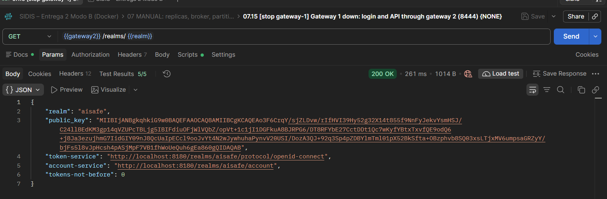
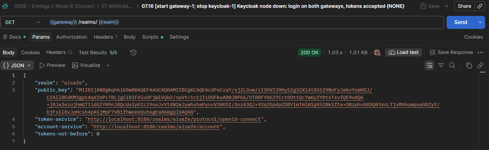

# AISafe – Infraestrutura (Entrega 2)

A documentação da Entrega 1 está no `README.md` desta pasta e continua válida para essa entrega. Este documento
descreve o que mudou na Entrega 2: mensagens assíncronas (RabbitMQ), base de dados por instância e infraestrutura
sem pontos únicos de falha.

**Modo de referência da Entrega 2: Modo B (Docker seguro, `docker-compose.secure.yml`).** É o que cumpre todos os
requisitos do enunciado ao mesmo tempo: pelo menos 2 instâncias por serviço, uma base de dados por instância, message
broker com AMQP, API externa REST, HTTPS em todos os saltos e nenhum ponto único de falha. O **Modo A (IntelliJ)**
também foi adaptado à Entrega 2 (RabbitMQ e uma PostgreSQL por réplica do FO, em Docker; secção 8), para
desenvolvimento e testes com 3 instâncias. O Modo C (só serviços) fica como na Entrega 1.

---

## 1. O que mudou face à Entrega 1

| Componente                 | Entrega 1                                   | Entrega 2                                                                                       |
|----------------------------|---------------------------------------------|-------------------------------------------------------------------------------------------------|
| Comunicação entre serviços | HTTPS (replicação e validações síncronas)   | **AMQP (RabbitMQ)**, assíncrona, com *transactional outbox*; HTTPS só como recurso              |
| Message broker             | —                                           | **Cluster de 3 nós RabbitMQ 3.13**, *quorum queues*, só **AMQPS** (porta 5671)                  |
| Topologia do broker        | —                                           | Importada por `rabbitmq-init` a partir de `rabbitmq/definitions.json`, antes dos serviços       |
| BD do Flight Operations    | H2 em memória                               | **PostgreSQL por réplica** (`fo-db-1`, `fo-db-2`), migrações Flyway                             |
| BD do Airports & Routes    | H2                                          | **PostgreSQL por réplica** (`airports-db-1`, `airports-db-2`), migrações Flyway                 |
| BD do Keycloak             | 1 PostgreSQL (ponto único de falha)         | **3 nós PostgreSQL + repmgr** (1 primário, 2 standby, failover automático)                      |
| Contentores no Modo B      | 13                                          | **23**                                                                                          |
| Gateways (NGINX)           | Nova tentativa só se a réplica não responde | Também em `502`/`503`/`504`, incluindo POST (`proxy_next_upstream ... http_503 non_idempotent`) |

Aircraft e Maintenance mantêm, nesta versão, a integração da Entrega 1 (REST e H2).

---

## 2. Arrancar (Modo B)

```powershell
cd infrastructure\docker
.\gen-certs.ps1          # só na primeira vez: cria o .env (segredos aleatórios) e os certificados
cd ..
docker compose -f docker-compose.secure.yml up -d --build
docker compose -f docker-compose.secure.yml ps -a --format "table {{.Name}}\t{{.Status}}"
```

Resultado esperado: **23 contentores**, todos `Up` (a maioria `healthy`) e o `rabbitmq-init` em `Exited (0)`.
A primeira vez demora mais (os standbys da BD do Keycloak copiam o primário).

Parar sem perder dados: `docker compose -f docker-compose.secure.yml down`. **Não usar `down -v`**: apaga os volumes
(todas as bases de dados e as filas).

### 2.1 Segredos do `.env`

Variáveis novas na Entrega 2 (todas `CHANGE_ME` no `.env.example`):

| Variável                              | Para quê                                        |
|---------------------------------------|-------------------------------------------------|
| `FO_DB_PASSWORD`                      | PostgreSQL de cada réplica do Flight Operations |
| `AIRPORTS_DB_PASSWORD`                | PostgreSQL de cada réplica do Airports & Routes |
| `RABBITMQ_USER` / `RABBITMQ_PASSWORD` | Utilizador do broker (serviços e consola)       |
| `RABBITMQ_ERLANG_COOKIE`              | Segredo partilhado entre os nós do cluster      |
| `KC_DB_ADMIN_PASSWORD`                | Utilizador `postgres` da BD do Keycloak         |
| `KC_REPMGR_PASSWORD`                  | Utilizador do repmgr (replicação)               |

Num `.env` novo, `.\gen-certs.ps1` substitui todos os `CHANGE_ME` por valores aleatórios. **Num `.env` que já está em
uso**, acrescentar só a variável que falta com um valor aleatório, para não mudar as palavras-passe das BDs que já
existem (que deixariam de aceitar a ligação):

```powershell
$pw = -join ((48..57)+(65..90)+(97..122) | Get-Random -Count 32 | % {[char]$_})
Add-Content .env "AIRPORTS_DB_PASSWORD=$pw"
```

O `.env` nunca vai para o Git nem para capturas de ecrã.

### 2.2 Contentores e portas

| Contentores                                   | Rede              | Portas publicadas no host                         |
|-----------------------------------------------|-------------------|---------------------------------------------------|
| `gateway-1`, `gateway-2`                      | edge + backend    | `8443`, `8444`                                    |
| `keycloak-1`, `keycloak-2`                    | backend           | — (através das gateways)                          |
| `keycloak-db-0`, `-1`, `-2`                   | backend           | —                                                 |
| `rabbitmq-1`, `-2`, `-3`                      | backend + edge    | consola em `127.0.0.1:15672`, `:15673`, `:15674`  |
| `rabbitmq-init` (termina após importar)       | backend           | —                                                 |
| `flight-operations-1/2` + `fo-db-1/2`         | backend           | —                                                 |
| `airports-routes-1/2` + `airports-db-1/2`     | backend           | —                                                 |
| `aircraft-1/2`, `maintenance-1/2`             | backend           | —                                                 |

A porta AMQP sem TLS (5672) está desligada; os serviços usam `rabbitmq-1:5671,rabbitmq-2:5671,rabbitmq-3:5671`.

---

## 3. Sem pontos únicos de falha

| Componente        | Instâncias                        | Com uma falha                                                                                             |
|-------------------|-----------------------------------|-----------------------------------------------------------------------------------------------------------|
| API Gateway       | 2 (`:8443`, `:8444`)              | O cliente usa a outra gateway                                                                             |
| Keycloak          | 2                                 | O outro nó continua a emitir tokens                                                                       |
| BD do Keycloak    | 3 (repmgr)                        | O repmgr promove um standby; o Keycloak liga-se ao novo primário (`targetServerType=primary`)             |
| RabbitMQ          | 3 (cluster, `pause_minority`)     | As *quorum queues* continuam com 2 de 3 nós; os clientes ligam-se a outro nó                              |
| Cada serviço      | 2 réplicas, cada uma com a sua BD | A gateway usa a outra réplica; as mensagens para a réplica parada ficam na sua fila                       |
| BD de uma réplica | 1 por réplica                     | A réplica responde `503`; a gateway repete o pedido na outra réplica (o cliente não vê o erro)            |
| Evento perdido    | —                                 | Flight Operations: a sincronização entre réplicas (`ReplicaSyncReconciler`, 20 s) repõe o estado em falta |

**Limitação que resta:** todos os contentores correm num único host Docker. Em produção usar-se-ia um orquestrador
com vários nós (Docker Swarm ou Kubernetes).

---

## 4. Verificar

**Cluster RabbitMQ** – consola `http://localhost:15672` (utilizador `RABBITMQ_USER`, palavra-passe
`RABBITMQ_PASSWORD` do `.env`): em *Overview → Nodes* aparecem os 3 nós; em *Queues* as filas são do tipo `quorum`.
Pela linha de comandos:
```powershell
docker compose -f docker-compose.secure.yml exec rabbitmq-1 rabbitmq-diagnostics cluster_status
```

**BD do Keycloak** – estado do repmgr (o `entrypoint.sh` é necessário na imagem Bitnami):
```powershell
docker compose -f docker-compose.secure.yml exec keycloak-db-0 /opt/bitnami/scripts/postgresql-repmgr/entrypoint.sh repmgr -f /opt/bitnami/repmgr/conf/repmgr.conf cluster show
```
Esperado: um nó `primary` e dois `standby`, todos `running`. A saída mostra a palavra-passe do repmgr na coluna
*Connection string*: tapá-la em capturas.

---

## 5. Testes manuais de tolerância a falhas (Entrega 2)

Cada comando escreve-se como `docker compose -f docker-compose.secure.yml <comando>`, dentro de `infrastructure`.

| #  | Antes de testar                                                                                                                                                                | Resultado esperado                                                                                                                                                         |
|----|--------------------------------------------------------------------------------------------------------------------------------------------------------------------------------|----------------------------------------------------------------------------------------------------------------------------------------------------------------------------|
| 1  | `stop rabbitmq-1`                                                                                                                                                              | Agendar continua a dar `201` e o voo aparece nas duas réplicas do FO                                                                                                       |
| 2  | `start rabbitmq-1`; `stop rabbitmq-1 rabbitmq-2 rabbitmq-3`                                                                                                                    | Agendar dá `201` (AP); a leitura dá `200` na réplica que escreveu e `404` na outra (evento no outbox)                                                                      |
| 3  | `start rabbitmq-1 rabbitmq-2 rabbitmq-3` e esperar ~60 s                                                                                                                       | As duas réplicas devolvem o voo (o outbox publicou o evento; nenhum evento perdido)                                                                                        |
| 4  | `stop` do primário da BD do Keycloak (ver `cluster show`) e esperar ~45 s                                                                                                      | Outro nó passa a `primary`; um novo login continua a funcionar                                                                                                             |
| 5  | `start` desse nó e esperar ~30 s                                                                                                                                               | O nó antigo volta como `standby` do novo primário                                                                                                                          |
| 6  | `stop flight-operations-2 fo-db-2`; `rm -f fo-db-2`; `docker volume rm aisafe_fo-db-2-data`; `up -d fo-db-2 flight-operations-2`; esperar ~90 s | No log do `flight-operations-2`: `BOOTSTRAP: N flights received, N applied`; as leituras dão `200` nas duas réplicas                                                       |
| 7  | `stop airports-routes-1 airports-routes-2 aircraft-1 aircraft-2`                                                                                                               | O FO continua a agendar voos com rotas e aviões já conhecidos (dados de referência locais)                                                                                 |
| 8  | `stop gateway-1`                                                                                                                                                               | Login e pedidos pela gateway 2 (`:8444`) continuam a funcionar                                                                                                             |
| 9  | `start gateway-1`; `stop keycloak-1`                                                                                                                                           | Login pelas duas gateways continua a funcionar; os tokens novos são aceites pelas duas réplicas do FO                                                                      |
| 10 | `start keycloak-1`; `stop fo-db-1`                                                                                                                                             | Leituras e escritas continuam a dar sucesso (a réplica 1 responde `503` e a gateway usa a réplica 2)                                                                       |
| 11 | `start fo-db-1` e esperar ~30 s                                                                                                                                                | A réplica 1 passa a ter todos os voos criados no teste 10: os eventos que ficaram na fila e, em até 20 s, os que foram para a *dead-letter* (sincronização entre réplicas) |

Capturas dos testes 8 e 9 (gateway e Keycloak em baixo):





As capturas dos restantes testes (broker, snapshot, BD do Keycloak e BD de uma réplica do FO) estão no `README_E2.md` do
Flight Operations (secção E2.13).

Os mesmos cenários (e mais alguns: partição com compensação, réplica do Airports em baixo, recuperação total) estão
na pasta **07** (18 pedidos, 07.01–07.18) da coleção do Postman `SIDIS – Entrega 2 Modo B (Docker)`
(`tests(postman)/SIDIS – Entrega 2 Modo B (Docker).postman_collection.json`): corre-se o comando que está entre `[ ]` no nome de cada
pedido e depois envia-se o pedido (**Send**, um a um). As pastas 00–06 correm no Runner (111 testes). Environment
`SIDIS` com `rabbitMgmt`, `rabbitUser` e `rabbitPassword` (o valor do `.env`).

---

## 6. Resolução de problemas (novos)

| Sintoma                                                                              | Causa                                                                                                                                                                      | O que fazer                                                                                                                                                                    |
|--------------------------------------------------------------------------------------|----------------------------------------------------------------------------------------------------------------------------------------------------------------------------|--------------------------------------------------------------------------------------------------------------------------------------------------------------------------------|
| `required variable X is missing a value` ao fazer `up` ou `down`                     | O `.env` não tem uma variável nova                                                                                                                                         | Acrescentá-la (secção 2.1) e repetir                                                                                                                                           |
| `unknown anchor '...' referenced`                                                    | Âncora YAML mal escrita no compose                                                                                                                                         | Confirmar o nome da âncora (`&nome` / `*nome`)                                                                                                                                 |
| `could not get current user name` no `repmgr`                                        | A imagem Bitnami corre com um utilizador sem nome                                                                                                                          | Chamar o `repmgr` através do `entrypoint.sh` (secção 4)                                                                                                                        |
| `port is already allocated` (15672)                                                  | Ficou um contentor antigo do RabbitMQ                                                                                                                                      | `docker compose -f docker-compose.secure.yml down --remove-orphans`                                                                                                            |
| O FO não arranca: `connection to ... refused` na BD                                  | A BD da réplica ainda não está `healthy` ou falta `DB_URL`                                                                                                                 | Esperar pelo `healthy`; confirmar `DB_URL` no compose                                                                                                                          |
| Mensagens na fila `fo.dead-letter`                                                   | Mensagens mal formadas ou que falharam 5 vezes (por exemplo, com a BD de uma réplica em baixo)                                                                             | Ver a mensagem na consola (*Queues → fo.dead-letter → Get messages*) e o log do serviço. Os voos são repostos sozinhos pelo `ReplicaSyncReconciler` (log `SYNC: ... repaired`) |
| O Airports não arranca: `Found non-empty schema(s) ... without schema history table` | A BD do Airports foi criada pelo Hibernate antes da passagem para o Flyway                                                                                                 | Uma vez: `down`, `docker volume rm aisafe_airports-db-1-data aisafe_airports-db-2-data`, `up -d --build` (os dados iniciais voltam a ser carregados)                           |
| Testes do Postman que publicam no RabbitMQ dão `401`                                 | `rabbitPassword` do environment diferente do `.env`                                                                                                                        | Atualizar a variável `rabbitPassword` no environment `SIDIS`                                                                                                                   |
| Erros `merge_schema` / `mnesia` no log de um nó do RabbitMQ ao arrancar              | O nó arrancou antes dos outros e ainda não se juntou ao cluster                                                                                                            | Transitório: confirmar com `exec rabbitmq-1 rabbitmqctl cluster_status` (3 *Running Nodes*) e `rabbitmq-diagnostics check_if_node_is_quorum_critical`                          |
| `keycloak-db-N ... dependency failed to start` no `up`; o Keycloak não arranca       | Esse nó era o primário antes de um failover: ao voltar, o repmgr copia de novo os dados do primário atual (`pg_rewind` e, se falhar, clonagem) e o `up` desiste de esperar | Esperar ~30 s, confirmar com `cluster show` (1 `primary`, 2 `standby`) e repetir `docker compose -f docker-compose.secure.yml up -d`                                           |
| Respostas `503` com `X-Served-By: 127.0.0.1:808x`, ou `401` com tokens válidos       | O NGINX (e/ou o Keycloak) do **Modo A** continua a correr e responde também na porta 8443                                                                                  | Parar o Modo A antes do Modo B: `Get-Process nginx` e `Stop-Process -Force`; confirmar com `netstat -ano` (no Modo B nada usa a porta 8180)                                    |

---

## 7. Limitações conhecidas

- Um único host Docker (ver secção 3).
- A imagem `bitnamilegacy/postgresql-repmgr:17.6.0` está fixada e já não recebe atualizações; alternativa compatível
  e mantida: `soldevelo/postgresql-repmgr`.
- Aircraft e Maintenance usam ainda a integração da Entrega 1; o contrato de eventos do Aircraft (`aircraft.events`)
  já está definido e o Flight Operations já o consome.
- A consola do RabbitMQ usa HTTP, mas só está publicada em `127.0.0.1`.
- No arranque a frio, o Keycloak espera pelo `keycloak-db-0` (`depends_on`). Com o sistema a correr não há
  dependência: o Keycloak liga-se a qualquer um dos 3 nós (`targetServerType=primary`).

---

## 8. Modo A (IntelliJ) na Entrega 2

Os serviços correm no IntelliJ (3 instâncias de cada); o RabbitMQ e as 3 PostgreSQL do FO correm em Docker. Usa as
mesmas portas que o Modo B: **parar sempre um modo antes de arrancar o outro**.

1. Parar o Modo B: `docker compose -f docker-compose.secure.yml stop`.
2. RabbitMQ e BDs do FO (primeira vez; nas seguintes, `docker compose -f docker-compose.services.yml start rabbitmq` e
   `docker start fo-db-a1 fo-db-a2 fo-db-a3`):
   ```powershell
   docker compose -f docker-compose.services.yml up -d rabbitmq
   docker run -d --name fo-db-a1 -p 5441:5432 -e POSTGRES_DB=flightops -e POSTGRES_USER=flightops -e POSTGRES_PASSWORD=flightops postgres:16-alpine
   docker run -d --name fo-db-a2 -p 5442:5432 -e POSTGRES_DB=flightops -e POSTGRES_USER=flightops -e POSTGRES_PASSWORD=flightops postgres:16-alpine
   docker run -d --name fo-db-a3 -p 5443:5432 -e POSTGRES_DB=flightops -e POSTGRES_USER=flightops -e POSTGRES_PASSWORD=flightops postgres:16-alpine
   ```
   Consola do RabbitMQ: `http://localhost:15672` (`aisafe` / `aisafe-mq`, credenciais de desenvolvimento).
3. Keycloak e gateway: `.\start-infra.ps1` (esperar por `http://localhost:8180`).
4. Variáveis nas Run Configurations (separadas por `;`):

   | Run Configuration                          | Variáveis acrescentadas                                              |
         |--------------------------------------------|----------------------------------------------------------------------|
   | `FlightOperationsApplication - Instance N` | `DB_URL=jdbc:postgresql://localhost:544N/flightops` (N = 1, 2, 3)    |
   | `Airports - Instância 1, 2, 3`             | `SPRING_RABBITMQ_USERNAME=aisafe;SPRING_RABBITMQ_PASSWORD=aisafe-mq` |

5. Só uma vez, ao passar para o Flyway: com o Airports parado, apagar as bases H2 antigas do Airports (na raiz do
   repositório): `Remove-Item data\airports_db_*.mv.db, data\airports_db_*.trace.db -ErrorAction SilentlyContinue`.
6. Arrancar por esta ordem: Aircraft 1–3, Airports 1–3, Flight Operations 1–3.
7. Testes: coleção `SIDIS – Entrega 2 Modo A (IntelliJ)` (`tests(postman)/SIDIS – Entrega 2 Modo A (IntelliJ).postman_collection.json`):
   pastas 00–07 no Runner (181 testes), 08–10 manuais.

Para voltar ao Modo B: parar os serviços no IntelliJ, fechar a janela do Keycloak, `.\start-infra.ps1 -Stop` (pára o
NGINX do Modo A), `docker stop fo-db-a1 fo-db-a2 fo-db-a3` e `docker compose -f docker-compose.services.yml stop rabbitmq`.
Confirmar com `Get-Process nginx -ErrorAction SilentlyContinue` (não pode aparecer nada).
